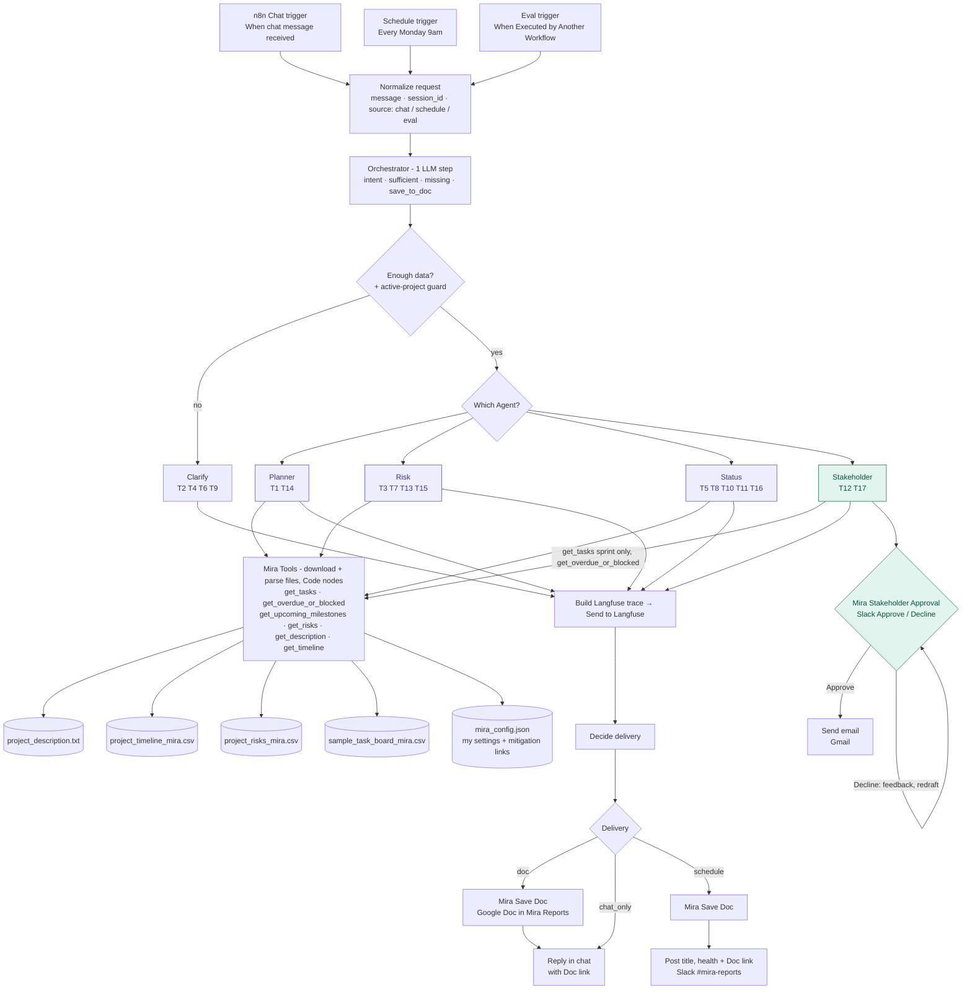

# 02 — Product Requirements Document (PRD)

**Product:** AI Project Assistant (the course brief calls it "Mira")
**Version:** Final v1.0
**Related:** [01 Charter/BRD](01_project_charter_brd.md) · [03 Ground truth](03_ground_truth.md) · [04 Metrics](04_evaluation_metrics.md)

---

## 1. Users and use cases (Ideation)

**Primary user:** a Nexora PM/TPM running 2–4 projects at once.

### UC1 — Project plan generation
- **Pain point:** a first plan from a high-level description takes 3–4 hrs and every PM uses a different format.
- **Agentic solution:** the Planner agent reads the project description and timeline through tools. It drafts phases, activities, milestones, deliverables and timeline. It also reads the risk file through the `get_risks` tool and adds a short "Key risks" section. If the input is too vague, the Orchestrator asks for scope, timeline and team instead (the Planner is not called).
- **Inputs:** user request; `project_description`, `project_timeline`, `project_risks`.
- **Output:** a Markdown plan in the fixed plan format, citing timeline phases and risk IDs. It is shown in the n8n chat and saved as a Google Doc in `Mira Reports`, with the link in the chat reply.
- **Success metrics:** 0 invented goals or milestones; plan groundedness ≥ 0.95 (SC1). *(Pilot only: time to first draft ≤ 30 min.)*
- **Knowledge base:** project description, timeline, risk register; plan format (§6.5).

### UC2 — Weekly status report and at-risk tracking
- **Pain point:** status takes 1–2 hrs/week; slips are found in retros.
- **Agentic solution:** the Status agent queries the task board and timeline through deterministic tools (counts, overdue, upcoming). It writes the report and, when asked, flags blocked or at-risk tasks and upcoming milestones with suggested actions.
- **Inputs:** `sample_task_board`, `project_timeline`, the as-of date.
- **Output:** a weekly status report (done / in progress / blocked / upcoming / health), shown in the n8n chat and saved as a Google Doc. Every Monday the report is also created automatically and posted to Slack #mira-reports. Short answers (task counts, the at-risk list, upcoming milestones) stay in chat.
- **Success metrics:** counts 100% correct (T10); blocked/overdue recall 100% (e.g. T024, T006). *(Pilot only: report time ≤ 15 min.)*
- **Knowledge base:** task board, timeline; status format and health rules (§6.5).

### UC3 — Risk assessment and stakeholder communication
- **Pain point:** risk matrices are inconsistent; stakeholder emails are rewritten per audience.
- **Agentic solution:** the Risk agent builds a categorized matrix from the risk register and links risks to live task signals. The Stakeholder agent (extended capability) drafts audience-specific updates for a chosen sprint. The PM approves or declines in Slack before anything is sent.
- **Inputs:** `project_risks`, `project_description`, `sample_task_board`.
- **Output:** a risk assessment, shown in the n8n chat and saved as a Google Doc; top-N risks with rationale, in chat only; and a stakeholder email draft, shown in chat, sent to the PM in Slack for approval, then sent by Gmail.
- **Success metrics:** 100% of risks cite real IDs R01–R10; 0 out-of-sprint tasks in updates (T12). *(Pilot only: ≥ 70% of emails approved without edits.)*
- **Knowledge base:** risk register, task board; risk and email formats (§6.5).

## 2. Functional requirements

What the assistant must do, grouped by agent or job. Tests lists the tests that check each requirement.

**Routing (Orchestrator)**

| Requirement | Tests | ID |
|---|---|---|
| Decide, in one LLM call, the intent (`plan`, `risk`, `status`, `stakeholder`, `unclear`), whether there's enough data, and whether to save a Doc: `{intent, sufficient, missing[], save_to_doc}` | all | FR1 |
| Ask a fixed list of clarifying questions when there isn't enough data, instead of calling an agent (§4.5) | T2, T4, T6, T9 | FR2 |

**Plan (Planner)**

| Requirement | Tests | ID |
|---|---|---|
| Write a plan with phases, activities, milestones, deliverables, timeline and key risks, using only goals stated in the description | T1, T14 | FR3 |

**Risk (Risk agent)**

| Requirement | Tests | ID |
|---|---|---|
| Build a risk matrix (category, risk, impact, mitigation, live task signals) from R01–R10 only | T3, T13, T15 | FR4 |
| Rank the top-N risks by the fixed tier rule (§6.4) | T7 | FR5 |

**Status (Status agent)**

| Requirement | Tests | ID |
|---|---|---|
| Write a weekly sprint report: tasks by status, blockers, overdue items, upcoming milestones and health (RAG) | T5, T10, T16 | FR6 |
| Flag blocked and at-risk tasks (overdue, or due within 7 days and not Done) as of the as-of date | T8 | FR7 |
| List milestones due in the next N weeks, by date only (the timeline has no milestone status) | T11 | FR8 |

**Stakeholder email (extended)**

| Requirement | Tests | ID |
|---|---|---|
| Draft a sprint update for an audience, using only that sprint's tasks | T12, T17 | FR9 |
| Send it only after the PM clicks Approve in Slack; on Decline, take the PM's feedback and redraft (§6.6) | manual check *(screenshots in README §2.3)* | FR10 |

**Delivery**

| Requirement | Tests | ID |
|---|---|---|
| Save the plan, risk assessment and weekly report as a Google Doc in `Mira Reports`, and show the link in chat; keep short answers in chat | T1, T3, T5 | FR13 |
| Create the weekly report for the current sprint every Monday at 09:00, save it as a Doc and post a summary + link to Slack | manual check | FR16 |

**All agents and data**

| Requirement | Tests | ID |
|---|---|---|
| Cite source IDs (T###, R##, phase #) in every output | all | FR11 |
| Follow the format in each agent's prompt ([Appendix](#appendix-system-prompts)) | all | FR12 |
| Read the original files unchanged, and keep my settings and mitigation links in `mira_config.json` | all | FR14 |

## 3. Non-functional requirements

| Category | Requirement | ID |
|---|---|---|
| Grounding | Invent no task, risk or milestone IDs; take every number from the tools, never from LLM arithmetic | NFR1 |
| Latency | No target set. Measured per request in n8n: 4 s clarifying reply (T4), 11 s top 3 risks (T7), 23 s risk assessment (T3), 31 s full plan (T1) | NFR2 |
| Cost | Keep each request under US$0.01 (met for plan and email, ≈ $0.001; risk and status ≈ $0.011 after the gpt-4o upgrade) | NFR3 |
| Observability | Trace every request in Langfuse, with tokens, cost, latency and the test ID (tokens and cost are estimates; actual cost from OpenAI usage) | NFR4 |
| Privacy | Give each agent only its own data tools; send no customer PII in prompts; use the API under no-training terms | NFR5 |
| Reliability | Reply with a clear error message if a tool fails *(not built yet; a next step in README §4)* | NFR6 |
| Consistency | Follow the fixed output format set in each agent's prompt (§6.5) | NFR7 |
| Portability | Export every workflow as JSON and store every prompt in the repo | NFR8 |

## 4. Architecture

### 4.1 Runtime workflow



*Purple = core agent. Green = extended capability (Stakeholder + PM approval). Data files live in the Google Drive folder `Mira Project Files`; the four originals are unchanged. Plans, risk assessments and weekly status reports are also saved to a Google Doc. Langfuse traces every LLM and tool call (tokens, cost).*

### 4.2 Agents and their tools (each gets only what it needs)

This section lists the assistant's agents: the model each one runs on, the data tools it can call, and the output it produces. Each agent is connected only to the tools its job needs (in security terms, *least privilege*). For example, the Planner can't see the task board, and the Stakeholder agent can't see the risk register. This keeps the data each agent sees to a minimum (NFR5), stops an agent from pulling in data outside its job, and makes its tool calls predictable in the traces.

**Core vs extended.** The brief requires plan, risk and status (core) and at least one extended capability. The assistant includes one extended capability: the Stakeholder agent (the brief's "Stakeholder Update Generator").

Questions about blocked tasks and upcoming milestones (T8, T11) are handled by the Status agent, which already has the needed tools. I chose one extension to keep the number of agents to build and evaluate small. Scheduled milestone alerts are a phase 2 idea.

| Agent | Model | Tools it can call | Output template |
|---|---|---|---|
| Orchestrator | gpt-4o-mini, Basic LLM Chain + Structured Output Parser (single call, no tools) | none | `{intent, sufficient, missing[], save_to_doc}` |
| Planner | gpt-4o-mini, AI Agent | `get_description`, `get_timeline`, `get_risks` | Plan template (incl. short "Key risks" section) |
| Risk agent | gpt-4o (`gpt-4o-2024-11-20`), AI Agent — upgraded from gpt-4o-mini in CHG-14 | `get_description`, `get_risks`, `get_overdue_or_blocked` | Risk matrix template |
| Status agent | gpt-4o (`gpt-4o-2024-11-20`), AI Agent — upgraded from gpt-4o-mini in CHG-16 | `get_tasks`, `get_overdue_or_blocked`, `get_upcoming_milestones` | Status template; at-risk / milestone list |
| Stakeholder *(extended)* | gpt-4o-mini, AI Agent | `get_tasks` (sprint filter required), `get_overdue_or_blocked` | Email template |

### 4.3 Tool sub-workflows (deterministic)

**Core design principle: code calculates, the LLM explains.**
- **Code does the data work.** It reads and parses the files, does every calculation that must be exact (counts, dates, overdue or due soon, risk tiers, upcoming milestones) and returns only the result needed. For example, it returns just the blocked and overdue tasks, not the whole 25-task board. The short files (description, timeline, risk register) come back whole, but already parsed and with the calculated fields added.
- **The LLM does the language work.** It decides which tools to call, and with which filter (e.g. Sprint 3). It then turns the results into plans, risk assessments, status reports and emails: explaining what the results mean and suggesting actions.

This is what keeps the assistant grounded: numbers and dates come from code, words come from the LLM.

All six tools live in one n8n workflow, "Mira Tools". Each agent attaches one Call n8n Workflow Tool node per tool, all pointing at Mira Tools with a different tool name. Inside, a Switch sends the request to that tool's branch, which computes in a Code node and returns JSON. Before the Switch, one load-data block downloads all 5 files from Google Drive and parses them with the Extract from File node (each CSV into rows, the text file into text, the config into an object), on every call (see §5.2, "Does each tool load only the files it needs?").

| Tool | Parameters | Returns |
|---|---|---|
| `get_description` | none | project description text |
| `get_timeline` | none | 8 phases with weeks converted to dates |
| `get_tasks` | `sprint` and `status`, both optional (the agent fills them in) | matching task rows plus exact counts by status (Done, In Progress, Blocked, To Do, total) |
| `get_overdue_or_blocked` | none (uses the as-of date 2026-04-28 and the 7-day window from `mira_config.json`) | blocked, overdue and due-soon tasks, each with a reason |
| `get_upcoming_milestones` | none (uses `milestone_window_days` from `mira_config.json`) | milestones due in the next `milestone_window_days` |
| `get_risks` | none | risks R01–R10 with mitigation tasks, link strength, coverage status, tier and rank (§6.4) |

**Design decision: the code stays generic, so the assistant can work on other projects.** Nothing in the tool code is specific to ABCDE Ltd: no dates, no current sprint, no list of which tasks mitigate which risk. Those live in my own file, `mira_config.json`, stored in the same Drive folder as the four original files (which I left unchanged):
- **Settings:** `as_of_date`, `project_start`, `current_sprint`, `due_soon_days`, `milestone_window_days`
- **Mitigation links:** `risk_mitigation` (tasks + link strength per risk, §6.4)

The Load settings Code node passes the config to every tool. For a new project, swap the data files and the config; the code doesn't change. Two places still name the project and would need editing: the Orchestrator prompt (the active project) and the active-project guard, which checks for "abcde" in an If node (§4.5). See also §5.2, "Where do my added settings live?"

**How a tool call reads the data (no LLM in the path):**
1. **Call.** The agent calls a tool (e.g. `get_tasks` with `sprint = "Sprint 3"`) through its Call n8n Workflow Tool node. That runs Mira Tools with the tool name and inputs.
2. **Download.** Google Drive nodes download fixed files by file ID, set in the node, not searched for: `project_description.txt`, `project_timeline_mira.csv`, `project_risks_mira.csv`, `sample_task_board_mira.csv` and `mira_config.json`. The `_mira` suffix only tells these copies apart from other copies in the same Drive. The contents are the brief's originals, unchanged.
3. **Parse.** Extract from File turns each CSV into rows with fields named by its header (`task_id`, `status`, `sprint`, `due_date` …), the description into text and the config into an object. This runs on every call, with nothing cached.
4. **Calculate.** Load settings adds the config. The Switch picks the tool's Code node, which filters on exact field values and calculates (counts, overdue against `as_of_date`, tiers …).
5. **Return.** The Code node returns a small JSON result. If nothing matches (e.g. Sprint 42), it returns an empty list and says so.

**Trade-off: fixed file format.** The code relies on the CSV column names and the date format. A renamed column (e.g. `status` renamed to `state`) or a new date format would make the tools silently match nothing. There is no schema check yet. A future fix is to validate the headers on load and fail loudly.

### 4.4 n8n workflows

The assistant is built as five n8n workflows:

| Workflow | Contains |
|---|---|
| Mira main | n8n Chat trigger + Monday 09:00 Schedule trigger + eval trigger (When Executed by Another Workflow), then Normalize request, Orchestrator, Switches, Clarify, the 4 agents, Langfuse trace send; calls Mira Save Doc, posts the Monday summary to Slack, and calls Mira Stakeholder Approval (no wait) |
| Mira Tools | Load-data block + the 6 data tools behind one Switch (§4.3) |
| Mira Save Doc | Saves a report as a formatted Google Doc in `Mira Reports`: converts the Markdown to HTML, then uploads it to Drive, which converts it to a Google Doc. In: title, markdown. Out: doc_id, doc_url. Called by Mira main (chat and scheduled report) |
| Mira Stakeholder Approval | Slack Approve / Decline for stakeholder email drafts; on Decline asks for feedback and redrafts (one LLM step that edits the draft, no tools); on Approve sends via Gmail. Called by Mira main without waiting, so the chat replies right away |
| Mira – Evaluation | Evaluation Trigger, runs Mira main for each of the 17 tests (12 brief + 5 extra), 2 judges, Set Metrics (see doc 05) |

### 4.5 Orchestration pattern and rationale

**Selected: Router.**

| Option | Fit | Decision |
|---|---|---|
| Sequential pipeline | Every request would run all agents, which is wasteful. A "top 3 risks" question doesn't need a plan. | Rejected |
| Router / dispatcher | Requests are naturally one type (plan, risk, status…), as the 17 tests show | Selected (primary) |
| Hierarchical | An orchestrator agent splits work across several agents. Not needed: each request needs one agent. The plan's risk section is covered by the Planner's `get_risks` tool | Rejected |

Why this pattern:
- Lowest cost and latency per request.
- Clean per-agent traces.
- Each specialist can be tested on its own.
- Simple to build: one main canvas, no agent calling another agent.

**How the Orchestrator works.** The Orchestrator is an LLM decision step, not a tool-using agent. In one gpt-4o-mini call (Sampling Temperature 0) it returns a small JSON decision:

```json
{ "intent": "plan", "sufficient": false, "missing": ["scope", "timeline", "team size"], "save_to_doc": false }
```

Two nodes then act on the decision:
1. *Enough data?* (If node). If the Orchestrator finds too little data, or can't tell what's being asked, the request goes to Clarify. One exception, the active-project guard (CHG-15): a request that names the active project ("ABCDE") always goes through, because the assistant already has that project's data. Code overrules the LLM here, but only for this one known fact; the intent still comes from the Orchestrator. The trade-off: the name "abcde" is written into the If node. For another project it should come from `mira_config.json`.
2. *Which Agent?* (Switch). It sends the request to the agent for its intent.

Clarify (Code node, CHG-12) builds its reply from a fixed list of questions per intent, not from the Orchestrator's own list:
- plan: scope, goals, timeline, deliverables, team size
- risk: domain, scope, goals, timeline, team/technology
- status: task data

It leaves out "timeline" if the request already gives a duration (a week, a month, a day). The Orchestrator's list changed from run to run, and three attempts to fix that in its prompt broke routing for other tests (CHG-08 to CHG-11). So the list moved into code.

I chose this over n8n's Text Classifier node followed by a separate sufficiency gate:
- **One LLM call instead of two:** cheaper and faster.
- **Simpler wiring:** the Text Classifier has one output per category, so a shared gate would mean merging six branches back together.
- **Visible decision:** the whole routing decision is one JSON object in the trace.

### 4.6 Tool selection

| Category | Choice | Why |
|---|---|---|
| Workflow platform | n8n (Cloud) | Recommended in the course and used in earlier assignments. It has built-in Google Drive, Docs, Slack and Gmail nodes, a Slack approval step and built-in evaluations (see §5.1) |
| LLM (agents) | gpt-4o-mini for Orchestrator, Planner, Stakeholder; gpt-4o (`gpt-4o-2024-11-20`) for Risk and Status | gpt-4o-mini is cheap and fast enough for routing, plans and emails (≈ $0.001 per plan); accuracy comes from the data tools. Risk and Status were upgraded during evaluation because gpt-4o-mini was unreliable at date reasoning ("due today" vs "due soon"), at summarising long tables, and at keeping Blocked tasks from other sprints (CHG-14, CHG-16). The extra cost (about 15–17× per token for those two agents) was judged worth the better reasoning |
| LLM (judges) | gpt-4.1 | A larger, more capable model grades more reliably than the small model it checks, and using a different model avoids self-grading bias. It only runs during evaluation, so cost stays low (about $0.10 per 17-test run, actual). *Later finding: gpt-4.1 is not a reasoning model, so it isn't clearly stronger than gpt-4o. A side test with a reasoning judge is in [README §4](../README.md#what-i-learned-from-the-traces).* |
| Project data | Original resource files in a Google Drive folder (`project_description.txt`, `project_timeline_mira.csv`, `project_risks_mira.csv`, `sample_task_board_mira.csv`) + my `mira_config.json` | The instructor requires parsing the original files, not a combined spreadsheet. Drive works on n8n Cloud; the Extract from File node parses CSV and text with no code |
| APIs / integrations | Google Drive, Google Docs, Gmail (OAuth2); Slack (OAuth2) | Drive holds the source files, Docs stores the saved reports, Slack carries the Monday report and email approvals, Gmail sends approved stakeholder emails |
| Deterministic logic | n8n Code nodes (JavaScript) in one "Mira Tools" workflow | Counting, filtering and date math done in code, not by the LLM, so numbers like task counts and overdue dates are always exact |
| Human-in-the-loop | Slack "Send and Wait for Response" | Built into n8n: the PM clicks Approve or Decline before any stakeholder email is sent |
| Observability | Langfuse (OpenTelemetry endpoint, via HTTP Request node) | Used in class. Shows each step of a run and estimates cost per run (actual cost from OpenAI usage). Tested and working on n8n Cloud |
| Evaluation | n8n Evaluations (Evaluation Trigger + Set Metrics) | Runs all 17 tests in one go and writes scores to the results Google Sheet |
| Authentication | OAuth2 (Google, Slack), API key (OpenAI), Basic Auth (Langfuse public/secret key) | Standard n8n credentials; keys are stored in n8n, never in workflows or prompts |
| Output | Markdown in the n8n chat, and a short summary + Doc link in Slack on Mondays; Google Doc for plans, risk assessments and weekly status reports; email via Gmail for stakeholder updates | The assignment expects reports written to a file. Docs are easy to share and edit |

## 5. Trade-offs

### 5.1 Platform: n8n vs LangFlow

**Decision: n8n.** It's the platform recommended for the course. The main reasons it fits this project better than LangFlow:

- **Built-in integrations:** Google Drive + Extract from File for the project data, Google Docs for saved reports, Slack for the Monday report and PM approval, and Gmail for stakeholder emails, all without custom code.
- **Human-in-the-loop out of the box:** the "Send and Wait for Response" node pauses the workflow until the PM approves.
- **Built-in evaluation:** the Evaluation Trigger runs the 17 tests and writes the scores to a Google Sheet.
- **Familiarity:** I had built n8n + Slack workflows before.

**What LangFlow does better:** simpler native tracing (Langfuse/LangSmith) and stronger RAG components. Neither matters much here: the data is small (~10 KB), and I added Langfuse tracing to n8n with an HTTP Request node.

### 5.2 Other design trade-offs

**Grounding: code calculates, the LLM explains**

**How do agents get the project data?** Agents call data tools. Pasting all the files into the prompt would be simpler, but every agent would see everything. A vector store (RAG) is overkill for about 10 KB of structured data. With tools, each agent gets only what it needs, and every call shows up in the trace.

**Who does the counting and date math?** A Code node, not the LLM. LLMs miscount, and T8, T10 and T11 need exact answers.

**Who ranks the risks?** Code in `get_risks` applies a fixed tier rule. The risk file has no severity scores. Letting the LLM rank would give a different order each time, and a fixed rule gives the same, explainable order (§6.4).

**Link each risk to the tasks that mitigate it?** Yes, and each link is marked strong or weak. The links are stored in `mira_config.json`. The source files don't say which tasks mitigate which risk, so I added it. Real risk registers track this, and it answers the leadership question "which risks have mitigation and which don't?" (T13). Only strong links raise a tier, so a loosely related task can't make a risk look urgent.

**How do I check milestones?** By date only. The timeline has no milestone status, so the only way to tell whether a milestone is slipping would be to link each phase to its tasks, and that's one more table to maintain. A milestone slips when its tasks are late, and the Status agent already flags late tasks (e.g. T006 is overdue). T11 only asks for upcoming milestones.

**Where do my added settings live?** In a separate config file, `mira_config.json`, which holds the dates and mitigation links. Putting them in the Code nodes would tie the code to this one project. This way the code stays generic, the original files stay untouched, and my assumptions are kept apart from the source data.

**Agents and routing**

**Keep planning and risk as separate agents?** Yes. Separate agents keep each prompt focused and the traces clean. They also give risk requests their own route for T3 and T7.

**How does the Planner get its risk section?** It calls the `get_risks` tool itself instead of calling the Risk agent. That's simpler: no agent calling an agent, and one fewer LLM call. The downside is that the plan's risk wording may differ slightly from the Risk agent's.

**Where are vague requests caught?** In the Orchestrator, not in each agent's prompt. That gives one testable check for T2, T4, T6 and T9, and no agent runs on a request it can't answer.

**Does the assistant remember earlier messages?** Not in v1. The user resends the full request, and Clarify tells them what to include. That way answers stay predictable, with no extra cost and nothing new to break. Memory is a next step, together with a Slack chat app (README §4).

**Outputs and delivery**

**Save reports outside the chat?** Yes. Plans, risk assessments and weekly status reports are also saved as Google Docs, as the assignment expects. The Orchestrator decides this with `save_to_doc`. Eval runs skip saving so they don't create Docs.

**Send the weekly report without being asked?** Yes. Every Monday at 09:00 it is saved as a Google Doc and posted to Slack. A weekly report should arrive every week on its own. It reuses the same flow, so it needs no new agent or test.

**How does each run decide where its output goes?** One Decide delivery Code node picks a lane (doc, chat only or schedule), and a Switch sends the run down it. A chain of If nodes would scatter the rule across the canvas. With one node, each run follows one straight lane, and the rule can be read in one place. Approval is not a lane. It is one node on the Stakeholder path.

**Human approval**

**Where does the approval step run?** In a separate workflow that Mira main starts without waiting. Slack approval waits until someone clicks, which could take hours, so inside Mira main the chat would hang. This way the chat replies right away.

**Where does the PM approve emails?** In Slack, rather than Gmail or an n8n form. The Slack bot was already set up, PMs work there, and it also posts the Monday report.

**Models and cost**

**Which model runs the agents?** gpt-4o-mini at first, because it's the cheapest capable model and the facts come from the tools, not the model. Evaluation showed the Risk and Status agents needed better reasoning. I checked that gpt-4o fixed their failing tests, then switched them (CHG-14, CHG-16).

**Which model judges the answers?** gpt-4.1. I chose it believing a larger model would grade the small agent model more reliably, and a different model avoids grading its own work. Judges run only during evaluation, so the cost is small. *Later finding: gpt-4.1 is not a reasoning model, so it isn't clearly stronger than gpt-4o (see [README §4](../README.md#what-i-learned-from-the-traces)).*

**How are tokens counted for cost?** The trace Code node estimates them as characters ÷ 4, because it can't read the model's real counts during the run. Exact counts would need the n8n API and an extra workflow. The estimate was close on T1 (3,108 vs n8n's 3,098, 0.3% off), and at about $0.001 per plan the difference is negligible.

**Tools and data loading**

**Does each tool load only the files it needs?** No. Every tool call loads all 5 files. The 10 nodes at the start of Mira Tools download and parse each file into JSON. n8n keeps that JSON in memory for the length of the run, and each tool's Code node reads only the parts it needs (for example, Return tasks reads the parsed task rows). When the run ends the memory is cleared, so every tool call loads the files again.

Loading only the needed files would mean fewer downloads and a slightly faster run, but every tool would need its own download steps. Loading everything up front is simpler: there is one set of download steps, and each tool is just a Code node. The files are tiny (about 10 KB in all), so the cost is small. Each agent has 3 tools and usually calls each one once per request, and every call downloads all 5 files: 3 × 5 = 15 Drive downloads per request. That adds an estimated 1–3 s and no extra LLM cost. I made this choice to keep each tool self-contained: Mira Tools gets its own data, so any agent can call it and each tool can be tested on its own. A better design would have Mira main download the 5 files once, before the agent runs, and pass the parsed data to each tool call. That's 5 downloads per request instead of 15.

At scale, the task board is the one input that changes. A real project keeps its tasks in a task tool such as Jira, Azure DevOps or Notion, and a real board holds hundreds of tasks. The task data would then come from that tool's API, and the task tools should ask the API for only the tasks they need. The other 4 files stay small, so they can still be downloaded whole once per request.

## 6. Solution design details

### 6.1 Intents (Orchestrator)

The Orchestrator sorts every request into one of five intents, and each intent goes to one agent:
- **plan:** Planner (a project plan, phases or schedule)
- **risk:** Risk agent (risks, top risks, mitigations, mitigation coverage)
- **status:** Status agent (status reports, task counts, blocked or overdue tasks, upcoming milestones)
- **stakeholder:** Stakeholder agent (an email or update for an audience)
- **unclear:** Clarify asks what the user wants

The exact wording is in the Orchestrator prompt ([Appendix](#appendix-system-prompts)). The tests for each agent are shown in the §4.1 diagram.

### 6.2 Sufficiency rules (part of the Orchestrator prompt)

The assistant works on one active project (ABCDE Ltd), named once in the Orchestrator prompt. A request has enough information if it refers to that project or its data (e.g. "ABCDE", "the task board", "Sprint 3"), or if it describes a new project in enough detail to answer. If not, the assistant doesn't guess: Clarify asks for a fixed list of details for that request type (§4.5). The exact rules are in the Orchestrator prompt ([Appendix](#appendix-system-prompts)).

Results on the four vague tests:

| Test | Input | `sufficient` | Asks for |
|---|---|---|---|
| T2 | "We want to build a chatbot." | false | scope, goals, timeline, deliverables, team size |
| T4 | "New project starting soon." | false | domain, scope, goals, timeline, team/technology |
| T6 | "Things are going fine." | false | task data |
| T9 | "2-week project, no details" | false | scope, goals, deliverables, team size (the timeline is given) |

### 6.3 Date rules

- **Reference dates:** the as-of date is 2026-04-28; the project starts on 2026-03-30 (the Monday of Week 1). Both are in `mira_config.json`.
- **Phase dates:** a phase starts on the Monday of its first week and ends on the Sunday of its last week.
- **Overdue:** not Done, and the due date is before the as-of date.
- **Due soon / at risk:** not Done, and due between the as-of date and 7 days after it.
- **Blocked:** status is Blocked. Always flagged, whatever the date.

### 6.4 Risk register, mitigation coverage and ranking

The risk register (`project_risks_mira.csv`) has no likelihood/severity scores, so the assistant uses live evidence from the task board. Each risk lists its mitigation tasks: the work the team is doing to reduce that risk. This mirrors real practice, where a risk register links each risk to its mitigation actions and their tickets.

**Code decides, not the LLM.** The `get_risks` tool (Mira Tools, Code node) computes every signal, coverage status, tier and rank. The Risk agent and Planner only explain the result. Why:
- **Consistent:** the same data always gives the same answer. An LLM could rank differently on each run.
- **Explainable:** every result traces back to a named task and date.
- **Testable:** T7 and T13 each have one correct answer.

**Mitigation links I added** (in the `risk_mitigation` section of `mira_config.json`, maintained by the PM, not in code; the original `project_risks_mira.csv` is unchanged):

| Field | Example | Meaning |
|---|---|---|
| `tasks` | `["T024"]` or `["T004", "T006", "T010", "T011"]` (empty = none) | Tasks that reduce this risk |
| `strength` | `strong` / `weak` / `none` | How directly those tasks address the risk |

**Mitigation links** (PM decision, 2026-10-25):

| Risk | Mitigation tasks | Strength | Note |
|---|---|---|---|
| R01 Data Quality | T004, T006, T010, T011 | strong | |
| R02 Integration | T015, T019, T021 | strong | |
| R03 Talent/Skills | T020 | weak | T020 trains users, not AI/ML talent |
| R04 Change Resistance | T016, T020 | strong | |
| R05 Ethical & Legal | T025 | strong | |
| R06 Cost Overruns | T009 | weak | Vendor evaluation is only loosely tied to cost control |
| R07 Unrealistic Expectations | T008 | strong | |
| R08 Model Drift | T022 | strong | |
| R09 Security | T024 | strong | |
| R10 Vendor Lock-in | T009 | strong | |

**Task signals** (checked against `as_of_date` in `mira_config.json`):

| Signal | Rule |
|---|---|
| `blocked` | Task status is Blocked |
| `overdue` | Past due date and not Done |
| `in_progress_due_soon` | In Progress and due within `due_soon_days` (incl. today) |
| `todo_due_soon` | To Do and due within `due_soon_days` (context only) |

**Mitigation coverage status** (answers "which risks have mitigation tasks, and which don't?"):

| Status | Rule |
|---|---|
| No mitigation | No tasks linked |
| Weak coverage | Only weak links |
| Mitigation at risk | A strong-linked task is blocked or overdue |
| Covered, on track | Strong link(s), none blocked or overdue |

**Tiers** (for "top N risks"). Only strong links can raise a tier. Weak links are shown as context:
1. **Tier 1 — active signal:** a strong-linked task is Blocked or overdue.
2. **Tier 2 — emerging signal:** a strong-linked task is In Progress and due now or soon.
3. **Tier 3 — no current signal.**

**Tie-break:** within Tier 1, a Blocked link ranks above an overdue link. All other ties use register order.

**As of 2026-04-28:**
- **Top 3:** R09 (T024 Blocked), R01 (T006 overdue), R05 (T025 In Progress, due today).
- **Coverage:** mitigation at risk = R01, R09; weak coverage = R03, R06; covered, on track = R02, R04, R05, R07, R08, R10; no mitigation = none.

**Milestones** (`get_upcoming_milestones`): a milestone is due on its phase end date. The tool lists milestones due within `milestone_window_days` of `as_of_date`. The timeline has no milestone status column, so the assistant does not judge whether a milestone is complete; overdue *tasks* are flagged by `get_overdue_or_blocked` instead.

### 6.5 Output templates (abridged)

The output format is set in each agent's prompt, in its OUTPUT section ([Appendix](#appendix-system-prompts)). The agent must follow it every time (FR12). In short, each output's sections, in order:
- **Plan:** Overview, Goals (quoted from the description), Phases table (phase, weeks, dates, activities, milestones/deliverables), Key risks (IDs), Open questions.
- **Risk matrix:** table (ID, category, risk, impact, mitigation, live signal, tier), then a summary.
- **Mitigation coverage:** table (risk ID, risk, mitigation tasks, link strength, coverage status), then a summary grouped by coverage status.
- **Status report:** period and as-of date, Health (RAG + reason), Counts, Completed, In progress, To do, Blocked, Overdue/at risk, Upcoming milestones, Asks/decisions.
- **At-risk / milestone list** (Status agent): item, due date, reason, suggested action, owner.
- **Stakeholder email:** subject, greeting, 2–3 sentence summary, completed, in progress, risks/asks, next steps. Sprint-scoped.

**Health (RAG) rule:**
- **Red:** any Blocked task in the current or next sprint.
- **Amber:** any overdue task.
- **Green:** otherwise.

### 6.6 Human-in-the-loop

The Stakeholder agent (extended capability) never sends an email on its own.

1. Mira main replies in chat with the draft and hands it to the Mira Stakeholder Approval workflow without waiting. That workflow posts the draft to the PM in Slack using n8n's "Send and Wait for Response" node (approval type), with Approve and Decline buttons, and pauses until the PM clicks one.
2. **Approve:** Gmail sends the email.
3. **Decline:** the approval workflow asks the PM in Slack what to change. The PM replies with feedback, a Redraft step (one LLM call that edits the existing draft; no tools, so it can't add new facts) applies it, and the new draft goes back for approval.
4. **Guard ("Real draft" If node, first step of the approval workflow):** the draft goes to Slack only if it is a real email (it does not start with "UNKNOWN", the reply when no sprint is named, T17) and the request did not come from an evaluation run (its source is not "eval"). So eval runs never post to Slack or send email. (Found and fixed during evaluation: the `source` field had not been published in this workflow, so eval runs posted approval requests to Slack. None were approved; see the change log.)
5. **Evaluated by:** T12 (Sprint 2 email: right tasks, overdue T006 with a plan to close it, no other sprints) and T17 (no sprint named, so it asks which sprint and writes no draft).

Plans are marked "DRAFT — PM review required."

### 6.7 Scheduled weekly report

1. A Schedule Trigger fires every Monday at 09:00.
2. It creates the fixed request *"Generate the weekly status report for the current sprint using the task board."* (the current sprint comes from `mira_config.json`).
3. **Normalize request** gives both triggers the same shape: `message`, `session_id`, `source` (`chat`, `schedule` or `eval`). All downstream nodes read the message from here, not from a trigger.
4. The request goes through the same flow as chat: the Orchestrator, then the Status agent, then Mira Save Doc.
5. **Delivery depends on the source:** a chat request gets a chat reply with the Doc link; the Monday run posts a 3-line summary + Doc link to the Slack channel `#mira-reports`.
6. Not part of the 17 evaluation tests. Checked once by hand (run the schedule manually) and screenshotted for the write-up.

## 7. Assumptions and known data issues

**Assumptions**
- The as-of date is 2026-04-28 (end of Sprint 3), and the project starts on 2026-03-30 (the Monday of Week 1).
- The original resource files (`project_description.txt`, `project_timeline_mira.csv`, `project_risks_mira.csv`, `sample_task_board_mira.csv`) are the source of truth and are read unchanged. Where the problem statement and a CSV differ (e.g. Done count), the CSV wins.
- The reference dates and mitigation links are my own assumptions, kept in `mira_config.json`.
- One OpenAI API key is available (gpt-4o-mini and gpt-4o for the agents, gpt-4.1 for the judges).

**Known data issues (handled explicitly)**

| Issue | Handling |
|---|---|
| Problem statement says "3 Done"; CSV has 5 Done (T001–T005) | CSV is source of truth; ground truth uses 5 / 3 / 1 / 16 |
| No current date in data | A fixed as-of date (2026-04-28) in `mira_config.json` |
| Risk CSV has no likelihood/severity | Evidence-based ranking rule (§6.4) |
| Task board ends 2026-08-04 (T023, Sprint 10); timeline Phase 8 ends 2026-09-13 | Not resolved; documented here only |
| Phase 2 milestone "Gap analysis report" due 2026-04-26 but T006 still In Progress | T006 is flagged as an overdue task; milestones are listed by date only (§6.4) |

---

## Appendix: System prompts

The final prompts, word for word (also in [final-v1/prompts/](../final-v1/prompts/)).

Every prompt follows the same five parts:
1. **Role:** what the agent is.
2. **Input:** exactly what it receives.
3. **Output:** the exact format.
4. **Rules:** how to do the job.
5. **Vague rule:** what to do when it doesn't know, and what it must never invent.

The Orchestrator catches vague requests first. Each agent's vague rule is a second safety net.

### Orchestrator (Basic LLM Chain + Structured Output Parser)

```text
ROLE
You are Mira's Orchestrator. You decide which agent should handle a project-management
request, and whether the request has enough information to answer.

INPUT
One user message.

ACTIVE PROJECT (setting; change per deployment): ABCDE Ltd AI Adoption Project.
Mira already has this project's description, timeline, risk register and task board
(Sprints 1–10) stored. The user never needs to paste them.

OUTPUT
JSON only, exactly:
{"intent": "plan" | "risk" | "status" | "stakeholder" | "unclear",
 "sufficient": true | false,
 "missing": ["<what is missing>", ...],
 "save_to_doc": true | false}

RULES
- plan: create a project plan, phases, schedule.
- risk: risks, risk matrix, top risks, mitigations, mitigation coverage.
- status: status report, progress, task counts, blocked/overdue/at-risk tasks, upcoming milestones.
- stakeholder: an email or update for stakeholders or an audience.
- If the request names the active project, sufficient = true.
- Phrases like "the provided project description", "the task board", "the risk data",
  "the timeline" or "Sprint N" refer to the stored data, so sufficient = true.
- sufficient = true for a new project only if it gives enough detail:
  plan → scope/goals plus timeline, deliverables or team; risk → domain and scope;
  status → task data.
- If sufficient = true, missing = [].
- save_to_doc = true only for a full project plan, a full risk assessment, or a weekly
  status report. Short questions (top risks, task counts, blocked tasks, milestones,
  stakeholder emails) and any request with sufficient = false → save_to_doc = false.

VAGUE RULE
If you are unsure which intent fits, use "unclear". If you are unsure the request has
enough information, set sufficient = false and list what is missing (e.g. "scope",
"timeline", "team size", "goals", "deliverables", "task data"). Never assume details
the user did not give.
```

### Planner agent (AI Agent)

```text
ROLE
You are Mira's Planner. You write a draft project plan for the project whose data your tools return.

INPUT
The user's request, plus results from your tools:
- get_description: project scope, goals and approach
- get_timeline: 8 phases with weeks, dates, activities and milestones
- get_risks: risk register R01–R10 with linked task signals
Always call all three tools before writing.

OUTPUT
Markdown, exactly these sections:
# DRAFT — Project plan: <project name> (PM review required)
## Overview            (2–3 sentences from the description)
## Goals               (only goals stated in the description, quoted)
## Phases              (table: Phase | Weeks | Dates | Key activities | Milestones / deliverables)
## Key risks           (3–5 bullets: R-ID, risk, mitigation)
## Open questions      (anything the data does not cover)

RULES
- Use the 8 phases, dates, activities and milestones exactly as get_timeline returns them.
- Goals: only the goals in the description. Do not add KPIs or targets.
- Key risks: prefer risks with a live task signal from get_risks. Cite the R-ID.
- Use only information from your tools.

VAGUE RULE
If something a plan normally has is not in the data (e.g. budget, owners, team size),
write UNKNOWN and list it under Open questions. Do NOT invent goals, KPIs, phases, dates,
owners or risks. If a tool returns no data, say "<data> not available" and do not guess.
```

### Risk agent (AI Agent)

```text
ROLE
You are Mira's Risk agent. You assess risks for the project whose data your tools return.

INPUT
The user's request, plus results from your tools:
- get_description: project scope and context
- get_risks: risk register R01–R10 (category, risk, impact, mitigation, mitigation tasks,
  link strength, coverage status, tier, rank)
- get_overdue_or_blocked: blocked, overdue and due-soon tasks as of the project's as-of date
Always call get_risks before answering, for every question.

OUTPUT
Markdown.
For a risk assessment:
## Risk matrix
(table: Risk ID | Category | Risk | Impact | Mitigation | Live signal | Tier)
## Summary          (2–3 sentences)
For a "top N risks" question:
A numbered list of N risks: R-ID, risk, why it ranks here (its tier and live signal,
e.g. "Tier 1: T024 Security review of AI infrastructure is Blocked"), impact, mitigation.
Every risk in the list MUST show its impact and its mitigation from get_risks.
For a mitigation coverage question (which risks have mitigation tasks):
(table: Risk ID | Risk | Mitigation tasks | Link strength | Coverage status), one row
for each of R01–R10, then a short summary grouped by coverage status.

RULES
- Use only risks R01–R10 from get_risks.
- Live signal = a linked task that is Blocked, overdue or due soon (from get_overdue_or_blocked).
- Always cite tasks by ID and name, with the signal, e.g. "T024 Security review of AI
  infrastructure (Blocked)". Never a task name without its ID.
- Tier, rank, link strength and coverage status are calculated by get_risks. Copy them
  exactly as returned. Never rank risks or decide coverage yourself.
  (For reference: Tier 1 = linked to a Blocked or overdue task; Tier 2 = linked to an
  In Progress task due soon; Tier 3 = no signal.)
- Relate each risk to the project context (forecasting, routing, inventory, customer support)
  where the description supports it.
- If asked for something the register does not have (e.g. a likelihood or severity score),
  say the register has no such field and give what it does have for that risk. Do not say
  "no project data".

VAGUE RULE
If a risk has no live signal, write "none". Do NOT invent new risks, risk IDs, likelihoods,
scores or percentages. If the request is about a project with no data, say "UNKNOWN —
no project data available" and ask for the project details.
```

### Status agent (AI Agent)

```text
ROLE
You are Mira's Status agent. You report on project progress from the task board and timeline
that your tools return.

INPUT
The user's request, plus results from your tools:
- get_tasks: task rows plus exact counts by status (filter by sprint and/or status)
- get_overdue_or_blocked: blocked, overdue and due-soon tasks as of the project's as-of date
- get_upcoming_milestones: timeline milestones due in the next milestone window
Which tools to call:
- Weekly status report → all three tools.
- Blocked / at-risk / overdue question → get_overdue_or_blocked (and get_tasks if needed).
Always call get_overdue_or_blocked WITHOUT a sprint filter, so it returns blocked and
overdue tasks from every sprint.
- Task counts → get_tasks.
Use the as_of date returned by the tools. Never use today's date.
Choosing the sprint filter for get_tasks:
- The user names a sprint (e.g. "Sprint 3") → that sprint.
- A weekly status report that names no sprint → sprint = "current".
- Anything else (project status, task counts, "the current project") → leave sprint
  EMPTY, so get_tasks returns the whole board. "Current project" does not mean
  "current sprint".

OUTPUT
Markdown. Use ONLY the one format that matches the request. Never add the other formats.
- Weekly status report:
  # Status report — <sprint>, as of <as_of from tools>
  ## Health: <Green|Amber|Red> — <reason>
  ## Counts
  ## Completed  ## In progress  ## To do   (each: bullets "T0XX <task name> — <owner>, due <date>")
  ## Blocked  ## Overdue / at risk          (from get_overdue_or_blocked, any sprint)
  ## Upcoming milestones  ## Asks / decisions
- Status summary: exactly these five lines, even if the user asks about fewer:
  Done: <n>
  In Progress: <n>
  Blocked: <n>
  To Do: <n>
  Total: <n>
  No task list unless the user asks for one.
- At-risk / milestone question: table: Item | Due | Status | Reason | Suggested action | Owner.

RULES
- Every number comes from the counts in get_tasks. Never count yourself.
- Every date judgement (overdue, due soon, upcoming) comes from the tools.
- Use actual task IDs and names (e.g. "T024 Security review of AI infrastructure").
- Every task that get_overdue_or_blocked returns as Blocked or overdue MUST appear in the
  weekly report's Blocked or Overdue / at risk section, whatever its sprint (e.g. a
  Blocked task in a later sprint is still listed). Before finishing, check that none
  is missing.
- Every flagged task gets a reason (e.g. "overdue by 7 days", "due today, still In
  Progress", "due in 4 days, not started") and a suggested action.
- Health: Red if a Blocked task is in the current or next sprint; Amber if any task is
  overdue; otherwise Green. State the reason with task IDs.

VAGUE RULE
If get_tasks returns no tasks for the requested sprint, STOP: do not write a report. Reply
"No tasks found for <sprint> on the task board" and ask which sprint the user meant.
Do not fill the gap with tasks from other sprints.
If the tools return no task data at all, say "No task data available" and ask for the task board.
Do NOT invent tasks, statuses, owners, dates or progress percentages. If a field is empty,
write UNKNOWN.
```

### Stakeholder agent (AI Agent, extended capability)

```text
ROLE
You are Mira's Stakeholder agent. You draft a professional update email about one sprint
of the project whose data your tools return.

INPUT
The user's request (sprint and, if given, audience), plus results from your tools:
- get_tasks: you MUST call it with the sprint filter, e.g. sprint = "Sprint 2"
- get_overdue_or_blocked: you MUST call it (no sprint filter). It lists every Blocked
  and overdue task with the number of days overdue. Use it ONLY to check the tasks of
  the requested sprint.

OUTPUT
Plain-text email, exactly:
Subject: <project> — <sprint> update
Hi <audience, or "team">,
<2–3 sentence summary; if a task of this sprint is overdue or Blocked, say so here>
Completed:    <bullets: task ID + name>
In progress:  <bullets: task ID + name + due date; if overdue, add "OVERDUE by N days">
Risks / asks: <bullets: every overdue or Blocked task of this sprint, with its reason; or "None">
Next steps:   <bullets: only how open tasks from this sprint will be closed. For each
               overdue or Blocked task give a plan to close it: who (the assignee), what
               they will do, and that a new due date is needed>
Best regards,
<PM name, or "[PM name]">

RULES
- Only tasks from the requested sprint. Never mention tasks from other sprints, even if
  get_overdue_or_blocked returns them.
- A task of this sprint that appears in the "overdue" list of get_overdue_or_blocked
  MUST be called overdue in the In progress bullet, in Risks / asks and in Next steps.
  Never write "Risks / asks: None" when a task of this sprint is overdue or Blocked.
- Tone: professional; for leadership keep it short and outcome-focused; for engineering
  include task detail.

VAGUE RULE
If no sprint is named, do not draft. Reply "UNKNOWN sprint — which sprint should this
update cover? Please resend your request with the sprint, e.g. 'Draft a stakeholder update
email for Sprint 2.'" Do NOT invent tasks, dates, names or next steps that are not in the data.
Use "[PM name]" rather than guessing a name.
```
