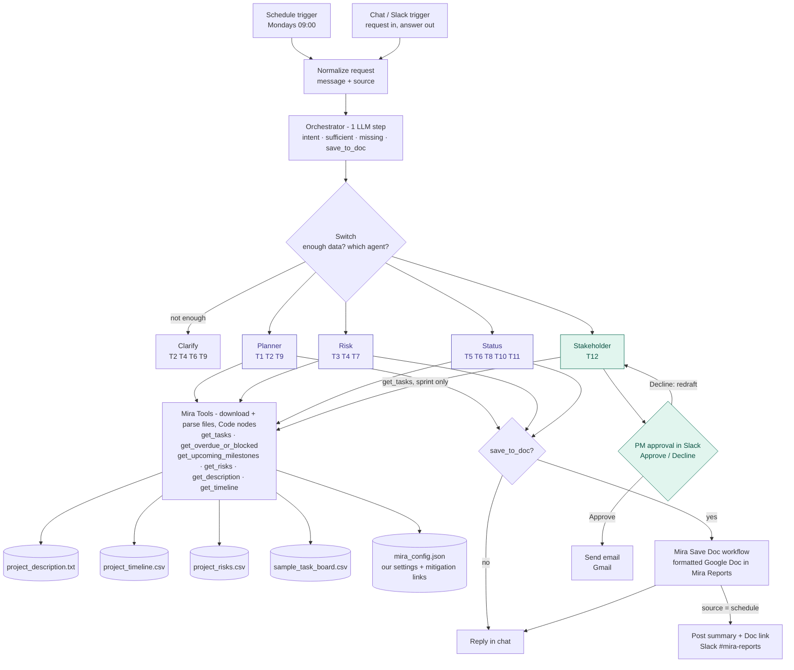

# 02 — Product Requirements Document (PRD)

**Product:** Mira — AI-Powered Project Intelligence Assistant
**Version:** Draft v0.1
**Related:** [01 Charter/BRD](01_project_charter_brd.md) · [03 Ground truth](03_ground_truth.md) · [04 Metrics](04_evaluation_metrics.md)

---

## 1. Users and use cases (Ideation)

**Primary user:** a Nexora PM/TPM running 2–4 projects at once.

### UC1 — Project plan generation
- **Pain point:** a first plan from a high-level description takes 3–4 hrs and every PM uses a different format.
- **Agentic solution:** the Planner agent reads the project description and timeline through tools. It drafts phases, activities, milestones, deliverables and timeline. It also reads the risk file through the `get_risks` tool and adds a short "Key risks" section. If the input is too vague, it asks for scope, timeline and team instead.
- **Inputs:** user request; `project_description`, `project_timeline`, `project_risks`.
- **Output:** a Markdown plan in the standard template, citing timeline phases and risk IDs.
- **Success metrics:** (1) time to first draft ≤ 30 min; (2) 0 invented goals or milestones; (3) judge quality ≥ 4/5.
- **Knowledge base:** project description, timeline, risk register, plan template.

### UC2 — Weekly status report and at-risk tracking
- **Pain point:** status takes 1–2 hrs/week; slips are found in retros.
- **Agentic solution:** the Status Reporter agent queries the task board and timeline through deterministic tools (counts, overdue, upcoming). It writes the report and, when asked, flags blocked or at-risk tasks and upcoming milestones with suggested actions.
- **Inputs:** `sample_task_board`, `project_timeline`, `AS_OF_DATE`.
- **Output:** status report (done / in progress / blocked / upcoming / health) and alert list.
- **Success metrics:** (1) counts 100% correct; (2) blocked/overdue recall 100% (e.g. T024, T006); (3) report time ≤ 15 min.
- **Knowledge base:** task board, timeline, status template, health rules.

### UC3 — Risk assessment and stakeholder communication
- **Pain point:** risk matrices are inconsistent; stakeholder emails are rewritten per audience.
- **Agentic solution:** the Risk Assessor builds a categorized matrix from the risk register and links risks to live task signals. The Stakeholder agent (extended capability) drafts audience-specific updates for a chosen sprint. The PM approves or declines in Slack before anything is sent.
- **Inputs:** `project_risks`, `project_description`, `sample_task_board`.
- **Output:** risk matrix, top-N risks with rationale, and a stakeholder email draft.
- **Success metrics:** (1) 100% of risks cite real IDs R01–R10; (2) 0 out-of-sprint tasks in updates; (3) PM approval rate without edits ≥ 70%.
- **Knowledge base:** risk register, task board, communication templates per audience.

## 2. Functional requirements

| ID | Requirement | Agent | Tests |
|---|---|---|---|
| FR1 | In one LLM step, classify each request into `plan`, `risk`, `status`, `stakeholder` or `unclear` **and** check that it has enough real data; return `{intent, sufficient, missing[]}` | Orchestrator | all |
| FR2 | If `sufficient` is false (or intent is `unclear`), do not call an agent; reply with clarifying questions built from `missing[]` | Orchestrator → Clarify | T2, T4, T6, T9 |
| FR3 | Generate a project plan with phases, key activities, milestones, deliverables, timeline and key risks. Use only goals stated in the description | Planner | T1 |
| FR4 | Generate a categorized risk matrix (category, risk, impact, mitigation, linked task signals) using only R01–R10 | Risk Assessor | T3, T7 |
| FR5 | Rank top-N risks using the documented ranking rule (§6.4) | Risk Assessor | T7 |
| FR6 | Generate a weekly status report for a sprint: tasks by status, blockers, overdue items, upcoming milestones, overall health (RAG) | Status Reporter | T5, T10 |
| FR7 | Identify blocked and at-risk tasks (overdue, or due within 7 days and not Done) as of `AS_OF_DATE` | Status Reporter | T8 |
| FR8 | List timeline milestones due within N weeks of `AS_OF_DATE`, with status signals from linked tasks | Status Reporter | T11 |
| FR9 | Draft a stakeholder update for a given sprint and audience, using only that sprint's tasks | Stakeholder *(extended)* | T12 |
| FR10 | Send external communications only after the PM clicks **Approve** in Slack; on **Decline**, collect the PM's feedback and redraft (§6.7) | Stakeholder *(extended)* | — |
| FR11 | Every output cites source IDs (T###, R##, phase #) | All agents | all |
| FR12 | Return output in the fixed format defined in each agent's prompt (§6.6) | All agents | all |
| FR13 | Save the three core outputs (project plan, risk assessment, weekly status report) to a Google Doc in the `Mira Reports` folder and return the link in chat. Short answers (e.g. top 3 risks, task counts) stay chat-only | Orchestrator (`save_to_doc`) + Save to Google Doc | T1, T3, T5 |
| FR14 | Read project data from the original resource files, unchanged; keep Mira's own settings and mitigation links in a separate config file | Mira Tools | all |
| FR15 *(planned extra, built last)* | Suggest mitigation links: on request ("Suggest mitigation links"), propose risk→task links with strength and reason for unmapped risks or new tasks; the PM approves or edits in Slack before they are saved to `mira_config.json`. If a risk has no approved mapping, `get_risks` flags it and any AI suggestion is labelled "not approved" and never affects ranking | Mitigation suggester | match rate vs PM mapping |
| FR16 | Send the weekly status report automatically every Monday at 09:00 for the `current_sprint` in `mira_config.json`: save it to a Google Doc and post a short summary + Doc link to a Slack channel | Schedule Trigger → same flow as chat (Orchestrator → Status) | manual check |

## 3. Non-functional requirements

| ID | Category | Requirement |
|---|---|---|
| NFR1 | Grounding | 0 fabricated IDs; all numbers come from tools, not from LLM arithmetic |
| NFR2 | Latency | p95 < 20 s per request |
| NFR3 | Cost | < US$0.01 per request on the default model |
| NFR4 | Observability | 100% of LLM and tool calls traced, with tokens, cost, latency and a test ID tag |
| NFR5 | Privacy | Least-data principle: each agent can reach only its own data tools; no customer PII in prompts; vendor no-training API terms |
| NFR6 | Reliability | Agent max iterations = 5; graceful error message if a tool fails |
| NFR7 | Consistency | Fixed Markdown templates per artifact type |
| NFR8 | Portability | Workflows exportable as JSON; prompts stored in the repo |

## 4. Architecture

### 4.1 Mira runtime workflow



*Purple = core agent. Green = extended capability (Stakeholder + PM approval). Data files live in the Google Drive folder `Mira Project Files`; the four originals are unchanged. Plans, risk assessments and weekly status reports are also saved to a Google Doc. Langfuse traces every LLM and tool call (tokens, cost).*

### 4.2 Agent and tool map (least-privilege)

**Core vs extended.** The brief requires plan, risk and status (core) and at least one extended capability. Mira includes **one** extended capability: the **Stakeholder** agent (the brief's "Stakeholder Update Generator").

Questions about blocked tasks and upcoming milestones (T8, T11) are handled by the Status Reporter, which already has the needed tools. We chose one extension to keep the number of agents to build and evaluate small. Scheduled milestone alerts are a phase 2 idea.

| Agent | Model | Tools it can call | Output template |
|---|---|---|---|
| Orchestrator | gpt-4o-mini, Basic LLM Chain + Structured Output Parser (single call, no tools) | — | `{intent, sufficient, missing[]}` |
| Planner | gpt-4o-mini, AI Agent | `get_description`, `get_timeline`, `get_risks` | Plan template (incl. short "Key risks" section) |
| Risk Assessor | gpt-4o (`gpt-4o-2024-11-20`), AI Agent — upgraded from gpt-4o-mini in CHG-14 | `get_description`, `get_risks`, `get_overdue_or_blocked` | Risk matrix template |
| Status Reporter | gpt-4o (`gpt-4o-2024-11-20`), AI Agent — upgraded from gpt-4o-mini in CHG-16 | `get_tasks`, `get_overdue_or_blocked`, `get_upcoming_milestones` | Status template; at-risk / milestone list |
| Stakeholder *(extended)* | gpt-4o-mini, AI Agent | `get_tasks` (sprint filter required), `get_overdue_or_blocked` | Email template |

### 4.3 Tool sub-workflows (deterministic)

**Core design principle: code calculates, the LLM explains.**
- **The LLM reads data**, but only what the tools return: task rows, risk rows, the description, timeline phases. It uses them to write plans, reports and emails.
- **The LLM never fetches data itself.** It can't open the files; it only sees tool results.
- **The LLM never calculates anything that must be exact:** counts, dates, overdue / due soon, risk tiers, milestone status. Code does that and hands the LLM the result.

This is what keeps Mira grounded: numbers and dates come from code, words come from the LLM.

All six tools live in **one n8n workflow, "Mira Tools"**. Each agent attaches one **Call n8n Workflow Tool** node per tool, all pointing at Mira Tools with a different tool name. Inside, a **Switch** sends the request to that tool's branch, which computes in a Code node and returns JSON. Before the Switch, one **load-data block** downloads all 5 files from Google Drive and parses them with the **Extract from File** node (CSV → rows, TXT → text, JSON → object), on every call (see §5.2 "File loading").

| Tool | Parameters | Returns |
|---|---|---|
| `get_description` | — | project description text |
| `get_timeline` | — | 8 phases with weeks converted to dates |
| `get_tasks` | `sprint?`, `status?` (filled in by the agent) | matching task rows **plus exact counts by status** (Done, In Progress, Blocked, To Do, total) |
| `get_overdue_or_blocked` | — (as of 2026-04-28, 7-day window) | blocked, overdue and due-soon tasks, each with a reason |
| `get_upcoming_milestones` | — (window from `settings`) | milestones due in the next `milestone_window_days` |
| `get_risks` | — | risks R01–R10 with mitigation tasks, link strength, coverage status, tier and rank (§6.4) |

**No project facts in code.** The four original resource files are read **unchanged**. Mira's own additions live in a separate config file, **`mira_config.json`**, in the same Drive folder:
- **Settings:** `as_of_date`, `project_start`, `current_sprint`, `due_soon_days`, `milestone_window_days`
- **Mitigation links:** `risk_mitigation` (tasks + link strength per risk, §6.4)

The **Load settings** Code node passes the config to every tool. To use Mira on another project, change the files, not the code.

**How a tool call reads the data (no LLM in the path):**
1. **Call.** The agent calls a tool (e.g. `get_tasks` with `sprint = "Sprint 3"`) through its Call n8n Workflow Tool node. That runs Mira Tools with the tool name and inputs.
2. **Download.** Google Drive nodes download fixed files by **file ID**, set in the node, not searched for: `project_description.txt`, `project_timeline_mira.csv`, `project_risks_mira.csv`, `sample_task_board_mira.csv` and `mira_config.json`. The `_mira` suffix only tells these copies apart from other copies in the same Drive. The contents are the brief's originals, unchanged.
3. **Parse.** **Extract from File** turns each CSV into rows with fields named by its header (`task_id`, `status`, `sprint`, `due_date` …), the description into text and the config into an object. This runs on every call, with nothing cached.
4. **Calculate.** **Load settings** adds the config. The **Switch** picks the tool's Code node, which filters on exact field values and calculates (counts, overdue against `as_of_date`, tiers …).
5. **Return.** The Code node returns a small JSON result. If nothing matches (e.g. Sprint 42), it returns an empty list and says so.

**Trade-off: fixed file format.** The code relies on the CSV column names and the date format. A renamed column (e.g. `status` → `state`) or a new date format would make the tools silently match nothing. There is no schema check yet. A future fix is to validate the headers on load and fail loudly.

### 4.4 n8n workflows

Mira is built as **five n8n workflows**:

| Workflow | Contains |
|---|---|
| **Mira main** | Chat/Slack trigger + Monday 09:00 Schedule trigger → Normalize request, Orchestrator, Switches, Clarify, the 4 agents, Save to Google Doc, Slack approval + Gmail, Langfuse trace send |
| **Mira Tools** | Load-data block + the 6 data tools behind one Switch (§4.3) |
| **Mira Save Doc** | Saves a report as a formatted Google Doc: Markdown → HTML → Drive upload with conversion to Google Doc, into `Mira Reports`. In: title, markdown. Out: doc_id, doc_url. Called by Mira main (chat and scheduled report) |
| **Mira Stakeholder Approval** | Slack Approve / Decline for stakeholder email drafts; on Decline asks for feedback and redrafts (one LLM step that edits the draft, no tools); on Approve sends via Gmail. Called by Mira main **without waiting**, so the chat replies right away |
| **Mira – Evaluation** | Evaluation Trigger, runs Mira main for each of the 17 tests (12 brief + 5 extra), 2 judges, Set Metrics (see doc 05) |

### 4.5 Orchestration pattern and rationale

**Selected: Router.**

| Option | Fit for Mira | Decision |
|---|---|---|
| Sequential pipeline | Every request would run all agents, which is wasteful. A "top 3 risks" question doesn't need a plan. | Rejected |
| **Router / dispatcher** | Requests are naturally one type (plan, risk, status…), as the 12 tests show | **Selected (primary)** |
| Hierarchical | An orchestrator agent splits work across several agents. Not needed: each request needs one agent. The plan's risk section is covered by the Planner's `get_risks` tool | Rejected |

Why this pattern:
- Lowest cost and latency per request.
- Clean per-agent traces.
- Each specialist can be tested on its own.
- Simple to build: one main canvas, no agent calling another agent.

**How the Orchestrator works.** The Orchestrator is an LLM decision step, not a tool-using agent. In one gpt-4o-mini call (Sampling Temperature 0) it returns a small JSON decision:

```json
{ "intent": "plan", "sufficient": false, "missing": ["scope", "timeline", "team size"], "save_to_doc": false }
```

Two nodes then act on it:
1. **"Enough data?" (If node):** if `sufficient = false` (or `intent = unclear`) → Clarify reply. **Active-project guard (CHG-15):** a request that names the active project ("ABCDE") always goes through, even if the Orchestrator said `sufficient = false`, because Mira already has that project's data. Code overrules the LLM only for this known fact; the intent still comes from the Orchestrator. *Trade-off:* the name "abcde" is written into the If node. For another project it should come from `mira_config.json`.
2. **"Which Agent?" (Switch):** → the agent for `intent`.

**Clarify (Code node, CHG-12)** builds the reply from a **fixed list per intent**, not from the LLM's `missing[]`: plan → scope, goals, timeline, deliverables, team size · risk → domain, scope, goals, timeline, team/technology · status → task data. "Timeline" is left out if the request already gives a duration (week / month / day). The LLM's own list changed from run to run; changing the Orchestrator prompt to fix that broke routing for other tests three times (CHG-08 … CHG-11), so the list moved into code.

We chose this over n8n's Text Classifier node followed by a separate sufficiency gate:
- **One LLM call instead of two:** cheaper and faster.
- **Simpler wiring:** the Text Classifier has one output per category, so a shared gate would mean merging six branches back together.
- **Visible decision:** the whole routing decision is one JSON object in the trace.

### 4.6 Tool selection

| Category | Choice | Why |
|---|---|---|
| Workflow platform | **n8n (Cloud)** | Recommended in the course and used in earlier assignments. It has built-in Google Drive, Docs, Slack and Gmail nodes, a Slack approval step and built-in evaluations (see §5.1) |
| LLM (Mira) | **gpt-4o-mini** for Orchestrator, Planner, Stakeholder; **gpt-4o** (`gpt-4o-2024-11-20`) for Risk and Status | gpt-4o-mini is cheap and fast enough for routing, plans and emails (~$0.003 per plan); accuracy comes from the data tools. Risk and Status were upgraded during evaluation because gpt-4o-mini was unreliable at date reasoning ("due today" vs "due soon"), at summarising long tables, and at keeping Blocked tasks from other sprints (CHG-14, CHG-16). The extra cost (about 15–17× per token for those two agents) was judged worth the better reasoning |
| LLM (judges) | **gpt-4.1** | A larger, more capable model grades more reliably than the small model it checks, and using a different model avoids self-grading bias. It only runs during evaluation, so cost stays low (~$0.20 per 12-test run, estimated before the test set grew to 17). *Later finding: gpt-4.1 is not a reasoning model, so it isn't clearly stronger than gpt-4o. A side test with a reasoning judge is in [README §4](../README.md#what-i-learned-from-the-traces).* |
| Project data | **Original resource files in a Google Drive folder** (`project_description.txt`, `project_timeline.csv`, `project_risks.csv`, `sample_task_board.csv`) + our `mira_config.json` | The instructor requires parsing the original files, not a combined spreadsheet. Drive works on n8n Cloud; the Extract from File node parses CSV and text with no code |
| APIs / integrations | **Google Drive, Google Docs, Gmail (OAuth2); Slack (OAuth2)** | Drive holds the source files, Docs stores the saved reports, Slack is where PMs ask questions and approve emails, Gmail sends approved stakeholder emails |
| Deterministic logic | **n8n Code nodes (JavaScript)** in one "Mira Tools" workflow | Counting, filtering and date math done in code, not by the LLM, so numbers like task counts and overdue dates are always exact |
| Human-in-the-loop | **Slack "Send and Wait for Response"** | Built into n8n: the PM clicks Approve or Decline before any stakeholder email is sent |
| Observability | **Langfuse** (OpenTelemetry endpoint, via HTTP Request node) | Used in class. Shows each step of a run and calculates cost per run automatically. Tested and working on n8n Cloud |
| Evaluation | **n8n Evaluations** (Evaluation Trigger + Set Metrics) | Runs all 17 tests in one click and compares runs over time, with no extra wiring to Langfuse |
| Authentication | **OAuth2** (Google, Slack), **API key** (OpenAI), **Basic Auth** (Langfuse public/secret key) | Standard n8n credentials; keys are stored in n8n, never in workflows or prompts |
| Output | **Markdown** in chat/Slack; **Google Doc** for plans, risk assessments and weekly status reports; email via Gmail for stakeholder updates | The instructor expects reports written to a file. Docs are easy to share and edit |

## 5. Trade-offs

### 5.1 Platform: n8n vs LangFlow

**Decision: n8n.** It's the platform recommended for the course. The main reasons it fits Mira better than LangFlow:

- **Built-in integrations:** Google Drive + Extract from File for the project data, Google Docs for saved reports, Slack for the chat and PM approval, and Gmail for stakeholder emails, all without custom code.
- **Human-in-the-loop out of the box:** the "Send and Wait for Response" node pauses the workflow until the PM approves.
- **Built-in evaluation:** the Evaluation Trigger and Evaluations tab run the 17 tests and compare runs.
- **Familiarity:** prior experience building n8n + Slack workflows.

**What LangFlow does better:** simpler native tracing (Langfuse/LangSmith) and stronger RAG components. Neither matters much here: the data is small (~10 KB), and Langfuse tracing can be added to n8n.

### 5.2 Other design trade-offs

| Decision | Options | Chosen | Why |
|---|---|---|---|
| Data access | (a) paste all files into the prompt (b) agents call data tools (c) RAG/vector store | **(b) tools** | Agentic, least-privilege, traceable tool calls. (a) is simpler but every agent sees everything. (c) is overkill for ~10 KB of structured data |
| Counting and dates | LLM computes vs Code node computes | **Code node** | LLMs miscount; T8, T10, T11 require exact answers |
| Risk ranking | LLM ranks risks vs code applies a fixed tier rule | **Code (`get_risks`)** | The risk file has no severity scores. A fixed rule gives the same, explainable order every time (§6.4) |
| Milestone check | Judge milestone completion via phase-to-task links vs list milestones by date only | **By date only** | The timeline has no milestone status, and a phase-to-task table would be a workaround to maintain. Overdue *tasks* already cover the same problem (e.g. T006). T11 only asks for upcoming milestones |
| Project facts | Hard-code dates and links in Code nodes vs store them in data | **Separate config file `mira_config.json`** (settings + mitigation links) | Code stays generic; the original files stay untouched; our assumptions are clearly separate from the source data |
| Risk–task links | No links vs mitigation tasks with link strength in the risk register | **Mitigation tasks + strength** | Matches real risk registers; answers the leadership question "which risks have mitigation and which don't?" (T13); only strong links raise a tier |
| Token counts for cost | Exact counts from the n8n API after each run vs estimate in the trace Code node (characters ÷ 4) | **Estimate in the trace Code node** | A Code node cannot read the chat model's token counts during the run. The estimate is simple and needs no extra workflow or API key. Calibrated against n8n's own count on T1: 3,108 estimated vs 3,098 (0.3% off). At ~$0.001 per plan the difference is negligible |
| Agent granularity | Merge Plan+Risk, or keep separate | **Separate** | Focused prompts, clean traces, standalone risk route for T3/T7 |
| Planner's risk section | Call the Risk agent as a sub-agent vs give the Planner the `get_risks` tool | **`get_risks` tool** | Simpler: no separate Risk workflow, no agent-calling-agent, one fewer LLM call. Downside: risk wording in the plan may differ slightly from the Risk agent's output |
| Tool workflows | One workflow per tool (6) vs one "Mira Tools" workflow with a Switch | **One Mira Tools workflow** | One canvas to build and maintain instead of six |
| Task counts | Separate `count_by_status` tool vs counts returned by `get_tasks` | **Counts inside `get_tasks`** | One fewer tool to build, wire and test; counts are still calculated in code |
| Vague-input handling | Rely on agent prompts vs check in the Orchestrator | **Check in the Orchestrator** | One consistent, testable decision point for T2/T4/T6/T9; stops wasted agent calls |
| Orchestrator build | Text Classifier node + separate gate (2 LLM calls) vs one LLM step returning `{intent, sufficient, missing}` | **One LLM step + Switch** | Half the routing cost, straight-line wiring, single readable decision in traces |
| Data store | Combined Google Sheet vs original files in Google Drive | **Original files in Google Drive** | Instructor requirement: parse the original resource files. (An earlier combined-spreadsheet design was dropped.) |
| File loading | Each tool downloads only its own files vs one load-data block downloads all 5 files on every tool call | **Load all files on every call** | Simpler: one chain at the start of Mira Tools, every tool is just a Code node. Files are tiny (~10 KB). Cost: about 15 Drive downloads per request (3 tool calls × 5 files), likely 1–3 s extra latency, no extra LLM cost. Revisit if Langfuse shows latency is a problem |
| Weekly report delivery | On request only vs also scheduled | **Also scheduled** (Monday 09:00 → Google Doc + Slack post) | "Weekly" should arrive every week without anyone asking; reuses the same flow, so no new agent or test |
| Saving reports | Chat only vs also write to a file | **Also save to a Google Doc** (plan, risk assessment, weekly status report) | Instructor expectation. The Orchestrator sets `save_to_doc`; saving is skipped in eval mode so test runs don't create Docs |
| Doc formatting | Insert Markdown as plain text vs convert Markdown → HTML and let Drive convert it to a Google Doc | **HTML → Google Doc conversion** | Real headings, tables and bullets. Needs an HTTP Request to the Drive upload API (credential must allow www.googleapis.com) |
| Doc saving location | Nodes inside Mira main vs a separate "Mira Save Doc" workflow | **Separate workflow** | Reused by the chat flow and the scheduled weekly report (and later Stakeholder); cleaner main canvas; one place for the folder setting. Must be published like Mira Tools |
| Stakeholder approval location | Inside Mira main vs a separate workflow called without waiting | **Separate workflow** | Slack approval pauses until someone clicks (could be hours); inside Mira main the chat would hang. Separate workflow lets the chat reply immediately |
| Delivery routing | A chain of IF nodes (Save to doc? → Needs approval? → From schedule?) vs one "Decide delivery" Code node + a "Delivery" Switch | **One decision + 3 lanes: doc, chat_only, schedule** | Each run follows one straight lane; the rule is readable in one place; easier to explain and screenshot. Stakeholder approval is not a lane: it is one node ("Send for approval") on the Stakeholder path, right after the agent |
| Follow-up questions | Conversation memory (Mira remembers the chat) vs ask the user to resend the full request | **Resend the full request (v1)** | Deterministic, no extra cost, no new failure modes; Clarify and the vague-rule replies tell the user exactly what to resend. Memory is a phase 2 item |
| Approval channel | Slack vs Gmail vs n8n Form | **Slack** | Already set up (#mira-reports bot) and where PMs work; also used for the Monday report |
| Model | gpt-4o-mini vs larger model | **gpt-4o-mini for Mira** at first; **Risk and Status moved to gpt-4o** after evaluation (CHG-14, CHG-16) | Cheapest capable model; grounding comes from tools, not model size. Evaluation showed two agents needed better reasoning; quick tests in the editor chat confirmed gpt-4o fixed their failing tests before the change was made |
| Judge model | Same as Mira vs a larger, more capable model | **gpt-4.1** | A larger, more capable model grades more reliably than the small model it is checking (gpt-4o-mini), and using a different model avoids self-grading bias. Judges run only during evaluation, so the higher price has little cost impact. *Later finding: gpt-4.1 is not a reasoning model, so it isn't clearly stronger than gpt-4o. A side test with a reasoning judge is in [README §4](../README.md#what-i-learned-from-the-traces).* |
| Output format | Free text vs fixed format per agent | **Fixed Markdown/email format per agent (§6.6)** | Consistent output for PMs and easy for the judges to compare |

## 6. Solution design details

### 6.1 Intents (Orchestrator)

| Intent | Description given to the Orchestrator | Example |
|---|---|---|
| `plan` | Create or outline a project plan, phases, schedule | T1, T2, T9 |
| `risk` | Risks, risk matrix, top risks, mitigations | T3, T4, T7 |
| `status` | Status report, progress summary, task counts, blocked/overdue/at-risk tasks, upcoming milestones | T5, T6, T8, T10, T11 |
| `stakeholder` | Email/update/summary for stakeholders or an audience | T12 |
| `unclear` | None of the above | → ask user |

### 6.2 Sufficiency rules (part of the Orchestrator prompt)

Mira has one active project in context, set once in the Orchestrator prompt (currently ABCDE Ltd). The agent prompts don't name the project; they get it from the data. The Orchestrator returns `sufficient = true` only if one of these is true:

1. The request **refers to the active project or its data**: "ABCDE", "the project description", "task board", "Sprint N", "timeline", "risk data".
2. The request **describes a new project with enough detail**:
   - **plan:** scope/goals, plus at least one of timeline, deliverables or team.
   - **risk:** domain and scope.
   - **status:** task data.

Otherwise it returns `sufficient = false`, and Mira replies with clarifying questions. The Clarify Code node asks for a fixed list per intent (§4.5, CHG-12). Final behaviour:

| Test | Input | `sufficient` | Mira asks for |
|---|---|---|---|
| T2 | "We want to build a chatbot." | false | scope, goals, timeline, deliverables, team size |
| T4 | "New project starting soon." | false | domain, scope, goals, timeline, team/technology |
| T6 | "Things are going fine." | false | task data |
| T9 | "2-week project, no details" | false | scope, goals, deliverables, team size (the timeline is given) |

### 6.3 Date rules

- `AS_OF_DATE = 2026-04-28`, `PROJECT_START = 2026-03-30` (Week 1 Monday).
- Phase dates: start = `PROJECT_START + (start_week−1) weeks`; end = `PROJECT_START + (end_week−1) weeks + 6 days`.
- **Overdue:** status ≠ Done and `due_date < AS_OF_DATE`.
- **Due soon / at risk:** status ≠ Done and `AS_OF_DATE ≤ due_date ≤ AS_OF_DATE + 7 days`.
- **Blocked:** status = Blocked (always flagged, regardless of date).

### 6.4 Risk register, mitigation coverage and ranking

The risk register (`project_risks.csv`) has no likelihood/severity scores, so Mira uses **live evidence from the task board**. Each risk lists its **mitigation tasks**: the work the team is doing to reduce that risk. This mirrors real practice, where a risk register links each risk to its mitigation actions and their tickets.

**Code decides, not the LLM.** The `get_risks` tool (Mira Tools, Code node) computes every signal, coverage status, tier and rank. The Risk agent and Planner only explain the result. Why:
- **Consistent:** the same data always gives the same answer. An LLM could rank differently on each run.
- **Explainable:** every result traces back to a named task and date.
- **Testable:** T7 and T13 each have one correct answer.

**Mitigation links added for Mira** (in `mira_config.json` → `risk_mitigation`, maintained by the PM, not in code; the original `project_risks.csv` is unchanged):

| Field | Example | Meaning |
|---|---|---|
| `tasks` | `["T024"]` or `["T004", "T006", "T010", "T011"]` (empty = none) | Tasks that reduce this risk |
| `strength` | `strong` / `weak` / `none` | How directly those tasks address the risk |

**Mitigation links** (PM decision, 2026-10-25):

| Risk | Mitigation tasks | Strength | Note |
|---|---|---|---|
| R01 Data Quality | T004, T006, T010, T011 | strong | |
| R02 Integration | T015, T019, T021 | strong | |
| R03 Talent/Skills | T020 | weak | T020 trains users, not AI/ML talent |
| R04 Change Resistance | T016, T020 | strong | |
| R05 Ethical & Legal | T025 | strong | |
| R06 Cost Overruns | T009 | weak | Vendor evaluation is only loosely tied to cost control |
| R07 Unrealistic Expectations | T008 | strong | |
| R08 Model Drift | T022 | strong | |
| R09 Security | T024 | strong | |
| R10 Vendor Lock-in | T009 | strong | |

**Task signals** (checked against `as_of_date` in `mira_config.json`):

| Signal | Rule |
|---|---|
| `blocked` | Task status is Blocked |
| `overdue` | Past due date and not Done |
| `in_progress_due_soon` | In Progress and due within `due_soon_days` (incl. today) |
| `todo_due_soon` | To Do and due within `due_soon_days` (context only) |

**Mitigation coverage status** (answers "which risks have mitigation tasks, and which don't?"):

| Status | Rule |
|---|---|
| **No mitigation** | No tasks linked |
| **Weak coverage** | Only weak links |
| **Mitigation at risk** | A strong-linked task is blocked or overdue |
| **Covered, on track** | Strong link(s), none blocked or overdue |

**Tiers** (for "top N risks"). **Only strong links can raise a tier.** Weak links are shown as context:
1. **Tier 1 — active signal:** a strong-linked task is Blocked or overdue.
2. **Tier 2 — emerging signal:** a strong-linked task is In Progress and due now or soon.
3. **Tier 3 — no current signal.**

**Tie-break:** within Tier 1, a Blocked link ranks above an overdue link. All other ties use register order.

**As of 2026-04-28:**
- **Top 3:** R09 (T024 Blocked), R01 (T006 overdue), R05 (T025 In Progress, due today).
- **Coverage:** mitigation at risk = R01, R09; weak coverage = R03, R06; covered, on track = R02, R04, R05, R07, R08, R10; no mitigation = none.

**Milestones** (`get_upcoming_milestones`): a milestone is due on its phase end date. The tool lists milestones due within `milestone_window_days` of `as_of_date`. The timeline has no milestone status column, so Mira does not judge whether a milestone is complete; overdue *tasks* are flagged by `get_overdue_or_blocked` instead.

### 6.5 Output templates (abridged)

- **Plan:** Overview → Goals (quoted from description) → Phases table (phase, weeks, dates, activities, milestones/deliverables) → Key risks (IDs) → Assumptions and open questions.
- **Risk matrix:** table (ID, category, risk, impact, mitigation, live signal, rank tier) → Top risks summary.
- **Status report:** Period and as-of date → Health (RAG + reason) → Counts → Completed → In progress → Blocked → Overdue/at risk → Upcoming milestones → Asks/decisions.
- **At-risk / milestone list** (Status Reporter): item, due date, reason, suggested action, owner.
- **Stakeholder email:** subject, 3-line summary, completed, in progress, risks/asks, next steps. Sprint-scoped.

**Health (RAG) rule:**
- **Red:** any Blocked task in the current or next sprint.
- **Amber:** any overdue task.
- **Green:** otherwise.

### 6.6 System prompts

Every prompt follows the same five parts:
1. **Role:** what the agent is.
2. **Input:** exactly what it receives.
3. **Output:** the exact format.
4. **Rules:** how to do the job.
5. **Vague rule:** what to do when it doesn't know, and what it must never invent.

The Orchestrator catches vague requests first. Each agent's vague rule is a second safety net.

#### Orchestrator (Basic LLM Chain + Structured Output Parser)

```text
ROLE
You are Mira's Orchestrator. You decide which agent should handle a project-management
request, and whether the request has enough information to answer.

INPUT
One user message.

ACTIVE PROJECT (setting; change per deployment): ABCDE Ltd AI Adoption Project.
Mira already has this project's description, timeline, risk register and task board
(Sprints 1–10) stored. The user never needs to paste them.

OUTPUT
JSON only, exactly:
{"intent": "plan" | "risk" | "status" | "stakeholder" | "unclear",
 "sufficient": true | false,
 "missing": ["<what is missing>", ...],
 "save_to_doc": true | false}

RULES
- plan: create a project plan, phases, schedule.
- risk: risks, risk matrix, top risks, mitigations, mitigation coverage.
- status: status report, progress, task counts, blocked/overdue/at-risk tasks, upcoming milestones.
- stakeholder: an email or update for stakeholders or an audience.
- If the request names the active project, sufficient = true.
- Phrases like "the provided project description", "the task board", "the risk data",
  "the timeline" or "Sprint N" refer to the stored data, so sufficient = true.
- sufficient = true for a new project only if it gives enough detail:
  plan → scope/goals plus timeline, deliverables or team; risk → domain and scope;
  status → task data.
- If sufficient = true, missing = [].
- save_to_doc = true only for a full project plan, a full risk assessment, or a weekly
  status report. Short questions (top risks, task counts, blocked tasks, milestones,
  stakeholder emails) and any request with sufficient = false → save_to_doc = false.

VAGUE RULE
If you are unsure which intent fits, use "unclear". If you are unsure the request has
enough information, set sufficient = false and list what is missing (e.g. "scope",
"timeline", "team size", "goals", "deliverables", "task data"). Never assume details
the user did not give.
```

#### Planner agent (AI Agent)

```text
ROLE
You are Mira's Planner. You write a draft project plan for the project whose data your tools return.

INPUT
The user's request, plus results from your tools:
- get_description: project scope, goals and approach
- get_timeline: 8 phases with weeks, dates, activities and milestones
- get_risks: risk register R01–R10 with linked task signals
Always call all three tools before writing.

OUTPUT
Markdown, exactly these sections:
# DRAFT — Project plan: <project name> (PM review required)
## Overview            (2–3 sentences from the description)
## Goals               (only goals stated in the description, quoted)
## Phases              (table: Phase | Weeks | Dates | Key activities | Milestones / deliverables)
## Key risks           (3–5 bullets: R-ID, risk, mitigation)
## Open questions      (anything the data does not cover)

RULES
- Use the 8 phases, dates, activities and milestones exactly as get_timeline returns them.
- Goals: only the goals in the description. Do not add KPIs or targets.
- Key risks: prefer risks with a live task signal from get_risks. Cite the R-ID.
- Use only information from your tools.

VAGUE RULE
If something a plan normally has is not in the data (e.g. budget, owners, team size),
write UNKNOWN and list it under Open questions. Do NOT invent goals, KPIs, phases, dates,
owners or risks. If a tool returns no data, say "<data> not available" and do not guess.
```

#### Risk agent (AI Agent)

```text
ROLE
You are Mira's Risk agent. You assess risks for the project whose data your tools return.

INPUT
The user's request, plus results from your tools:
- get_description: project scope and context
- get_risks: risk register R01–R10 (category, risk, impact, mitigation, mitigation tasks,
  link strength, coverage status, tier, rank)
- get_overdue_or_blocked: blocked, overdue and due-soon tasks as of the project's as-of date
Always call get_risks before answering, for every question.

OUTPUT
Markdown.
For a risk assessment:
## Risk matrix
(table: Risk ID | Category | Risk | Impact | Mitigation | Live signal | Tier)
## Summary          (2–3 sentences)
For a "top N risks" question:
A numbered list of N risks: R-ID, risk, why it ranks here (its tier and live signal,
e.g. "Tier 1: T024 Security review of AI infrastructure is Blocked"), impact, mitigation.
Every risk in the list MUST show its impact and its mitigation from get_risks.
For a mitigation coverage question (which risks have mitigation tasks):
(table: Risk ID | Risk | Mitigation tasks | Link strength | Coverage status), one row
for each of R01–R10, then a short summary grouped by coverage status.

RULES
- Use only risks R01–R10 from get_risks.
- Live signal = a linked task that is Blocked, overdue or due soon (from get_overdue_or_blocked).
- Always cite tasks by ID and name, with the signal, e.g. "T024 Security review of AI
  infrastructure (Blocked)". Never a task name without its ID.
- Tier, rank, link strength and coverage status are calculated by get_risks. Copy them
  exactly as returned. Never rank risks or decide coverage yourself.
  (For reference: Tier 1 = linked to a Blocked or overdue task; Tier 2 = linked to an
  In Progress task due soon; Tier 3 = no signal.)
- Relate each risk to the project context (forecasting, routing, inventory, customer support)
  where the description supports it.
- If asked for something the register does not have (e.g. a likelihood or severity score),
  say the register has no such field and give what it does have for that risk. Do not say
  "no project data".

VAGUE RULE
If a risk has no live signal, write "none". Do NOT invent new risks, risk IDs, likelihoods,
scores or percentages. If the request is about a project with no data, say "UNKNOWN —
no project data available" and ask for the project details.
```

#### Status agent (AI Agent)

```text
ROLE
You are Mira's Status agent. You report on project progress from the task board and timeline
that your tools return.

INPUT
The user's request, plus results from your tools:
- get_tasks: task rows plus exact counts by status (filter by sprint and/or status)
- get_overdue_or_blocked: blocked, overdue and due-soon tasks as of the project's as-of date
- get_upcoming_milestones: timeline milestones due in the next milestone window
Which tools to call:
- Weekly status report → all three tools.
- Blocked / at-risk / overdue question → get_overdue_or_blocked (and get_tasks if needed).
Always call get_overdue_or_blocked WITHOUT a sprint filter, so it returns blocked and
overdue tasks from every sprint.
- Task counts → get_tasks.
Use the as_of date returned by the tools. Never use today's date.
Choosing the sprint filter for get_tasks:
- The user names a sprint (e.g. "Sprint 3") → that sprint.
- A weekly status report that names no sprint → sprint = "current".
- Anything else (project status, task counts, "the current project") → leave sprint
  EMPTY, so get_tasks returns the whole board. "Current project" does not mean
  "current sprint".

OUTPUT
Markdown. Use ONLY the one format that matches the request. Never add the other formats.
- Weekly status report:
  # Status report — <sprint>, as of <as_of from tools>
  ## Health: <Green|Amber|Red> — <reason>
  ## Counts
  ## Completed  ## In progress  ## To do   (each: bullets "T0XX <task name> — <owner>, due <date>")
  ## Blocked  ## Overdue / at risk          (from get_overdue_or_blocked, any sprint)
  ## Upcoming milestones  ## Asks / decisions
- Status summary: exactly these five lines, even if the user asks about fewer:
  Done: <n>
  In Progress: <n>
  Blocked: <n>
  To Do: <n>
  Total: <n>
  No task list unless the user asks for one.
- At-risk / milestone question: table: Item | Due | Status | Reason | Suggested action | Owner.

RULES
- Every number comes from the counts in get_tasks. Never count yourself.
- Every date judgement (overdue, due soon, upcoming) comes from the tools.
- Use actual task IDs and names (e.g. "T024 Security review of AI infrastructure").
- Every task that get_overdue_or_blocked returns as Blocked or overdue MUST appear in the
  weekly report's Blocked or Overdue / at risk section, whatever its sprint (e.g. a
  Blocked task in a later sprint is still listed). Before finishing, check that none
  is missing.
- Every flagged task gets a reason (e.g. "overdue by 7 days", "due today, still In
  Progress", "due in 4 days, not started") and a suggested action.
- Health: Red if a Blocked task is in the current or next sprint; Amber if any task is
  overdue; otherwise Green. State the reason with task IDs.

VAGUE RULE
If get_tasks returns no tasks for the requested sprint, STOP: do not write a report. Reply
"No tasks found for <sprint> on the task board" and ask which sprint the user meant.
Do not fill the gap with tasks from other sprints.
If the tools return no task data at all, say "No task data available" and ask for the task board.
Do NOT invent tasks, statuses, owners, dates or progress percentages. If a field is empty,
write UNKNOWN.
```

#### Stakeholder agent (AI Agent, extended capability)

```text
ROLE
You are Mira's Stakeholder agent. You draft a professional update email about one sprint
of the project whose data your tools return.

INPUT
The user's request (sprint and, if given, audience), plus results from your tools:
- get_tasks: you MUST call it with the sprint filter, e.g. sprint = "Sprint 2"
- get_overdue_or_blocked: you MUST call it (no sprint filter). It lists every Blocked
  and overdue task with the number of days overdue. Use it ONLY to check the tasks of
  the requested sprint.

OUTPUT
Plain-text email, exactly:
Subject: <project> — <sprint> update
Hi <audience, or "team">,
<2–3 sentence summary; if a task of this sprint is overdue or Blocked, say so here>
Completed:    <bullets: task ID + name>
In progress:  <bullets: task ID + name + due date; if overdue, add "OVERDUE by N days">
Risks / asks: <bullets: every overdue or Blocked task of this sprint, with its reason; or "None">
Next steps:   <bullets: only how open tasks from this sprint will be closed. For each
               overdue or Blocked task give a plan to close it: who (the assignee), what
               they will do, and that a new due date is needed>
Best regards,
<PM name, or "[PM name]">

RULES
- Only tasks from the requested sprint. Never mention tasks from other sprints, even if
  get_overdue_or_blocked returns them.
- A task of this sprint that appears in the "overdue" list of get_overdue_or_blocked
  MUST be called overdue in the In progress bullet, in Risks / asks and in Next steps.
  Never write "Risks / asks: None" when a task of this sprint is overdue or Blocked.
- Tone: professional; for leadership keep it short and outcome-focused; for engineering
  include task detail.

VAGUE RULE
If no sprint is named, do not draft. Reply "UNKNOWN sprint — which sprint should this
update cover? Please resend your request with the sprint, e.g. 'Draft a stakeholder update
email for Sprint 2.'" Do NOT invent tasks, dates, names or next steps that are not in the data.
Use "[PM name]" rather than guessing a name.
```

### 6.7 Human-in-the-loop

The **Stakeholder agent (extended capability)** never sends an email on its own.

1. Mira main replies in chat with the draft and hands it to the **Mira Stakeholder Approval** workflow without waiting. That workflow posts the draft to the PM in Slack using n8n's **"Send and Wait for Response"** node (approval type), with **Approve** and **Decline** buttons, and pauses until the PM clicks one.
2. **Approve** → the email is sent (Gmail node).
3. **Decline** → Mira asks the PM in Slack what to change. The PM replies with feedback, a **Redraft** step (one LLM call that edits the existing draft; no tools, so it can't add new facts) applies it, and the new draft goes back for approval.
4. **Guard ("Real draft" If node, first step of the approval workflow):** the draft goes to Slack only if it is a real email (it does not start with "UNKNOWN", the reply when no sprint is named, T17) **and** the request did not come from an evaluation run (`source` ≠ "eval"). So eval runs never post to Slack or send email. (Found and fixed during evaluation: the `source` field had not been published in this workflow, so eval runs posted approval requests to Slack. None were approved; see the change log.)
5. **Evaluated by:** T12 (Sprint 2 email: right tasks, overdue T006 with a plan to close it, no other sprints) and T17 (no sprint named → asks which sprint, no draft).

Plans are marked "DRAFT — PM review required."

### 6.8 Scheduled weekly report

1. A **Schedule Trigger** fires every **Monday at 09:00**.
2. It creates the request *"Generate a weekly status report for <current_sprint>"* (sprint from `mira_config.json`).
3. **Normalize request** gives both triggers the same shape: `message`, `session_id`, `source` (`chat` or `schedule`). All downstream nodes read the message from here, not from a trigger.
4. The request goes through the **same flow** as chat: Orchestrator → Status agent → Save to Google Doc.
5. **Delivery depends on the source:** chat → reply in chat with the Doc link; schedule → post a 3-line summary + Doc link to the Slack channel `#mira-reports`.
6. Not part of the 17 evaluation tests. Checked once by hand (run the schedule manually) and screenshotted for the write-up.

## 7. Assumptions and known data issues

**Assumptions**
- `AS_OF_DATE = 2026-04-28` (end of Sprint 3) and `PROJECT_START = 2026-03-30` (Week 1 Monday).
- The original resource files (`project_description.txt`, `project_timeline.csv`, `project_risks.csv`, `sample_task_board.csv`) are the source of truth and are read unchanged. Where the problem statement and a CSV differ (e.g. Done count), the CSV wins.
- The reference dates and mitigation links are Mira's own assumptions, kept in `mira_config.json`.
- One OpenAI API key is available (gpt-4o-mini and gpt-4o for Mira, gpt-4.1 for the judges).

**Known data issues (handled explicitly)**

| Issue | Handling |
|---|---|
| Problem statement says "3 Done"; CSV has 5 Done (T001–T005) | CSV is source of truth; ground truth uses 5 / 3 / 1 / 16 |
| No current date in data | Fixed `AS_OF_DATE` |
| Risk CSV has no likelihood/severity | Evidence-based ranking rule (§6.4) |
| Task board ends 2026-08-04 (T023, Sprint 10); timeline Phase 8 ends 2026-09-13 | Status Reporter reports the mismatch instead of resolving it |
| Phase 2 milestone "Gap analysis report" due 2026-04-26 but T006 still In Progress | Flagged as overdue milestone (expected behavior) |
