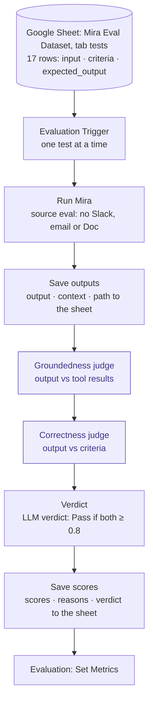

# 05 — Metric Implementation and LLM Cost

**Related:** [04 Metrics](04_evaluation_metrics.md) · [03 Ground truth](03_ground_truth.md) · [`ground_truth.json`](../data/ground_truth.json)

---

## Part A — Metric implementation

### A1. Evaluation workflow

Each test runs through the assistant, two LLM judges score the answer, and everything is written to the results sheet. Mira main sends its own Langfuse trace for each test, tagged with the test ID.



*Purple = LLM judge. With source "eval", Mira main skips the Slack approval, sends no emails and saves no Google Docs.*

### A2. What each judge receives (variable mapping)

Each judge is one prompt scoring one thing, with variables filled from the run.

| Variable | Where it comes from | Groundedness | Correctness |
|---|---|---|---|
| `{{input}}` | Dataset row `input` (the test prompt) | ✓ | ✓ |
| `{{output}}` | The assistant's final answer | ✓ | ✓ |
| `{{context}}` | What the tools returned in that run (task rows, risk rows, timeline, description). The agents have "Return Intermediate Steps" turned on, so Mira main returns the tool results alongside the answer | ✓ | — |
| `{{criteria}}` | Dataset row `criteria`: the marking scheme, a short fixed list of what must be in the answer (from `judge_criteria` in `ground_truth.json`) | — | ✓ (grades against this) |
| `{{expected_output}}` | Dataset row `expected_output`: the model answer, a full description with all facts | — | ✓ (fact check only) |

> **Why groundedness uses `{{context}}` and not `{{expected_output}}`:** groundedness asks "did the assistant make anything up compared with what it actually retrieved?" Comparing against the answer key would measure correctness, which is a different question. For tests where the assistant asks for clarification, no tools run, so the context is empty. The answer should then make no factual claims, which scores 1.

### A3. Judge 1 — Groundedness prompt (v1, unchanged since baseline)

Exactly as in n8n (`final-v1/prompts/groundedness_judge.txt`). The `{{ $(...) }}` parts are n8n expressions that fill in the test input, the tool results (`context`) and the assistant's answer. The JSON format is enforced by a Structured Output Parser.

```text
You are evaluating whether an AI project assistant's answer is grounded in the data it retrieved.

USER REQUEST:
{{ $('Evaluation Trigger').item.json.input }}

RETRIEVED CONTEXT (the only facts the assistant was allowed to use):
{{ $('Run Mira').item.json.context }}

ASSISTANT OUTPUT:
{{ $('Run Mira').item.json.output }}

Instructions:
1. List every factual claim in the output about the project: task IDs/names, statuses,
   owners, due dates, counts, milestones, phases, risk IDs/descriptions, goals, percentages.
2. For each claim, decide: SUPPORTED (stated in or directly computable from the context)
   or UNSUPPORTED.
3. score = supported claims / total claims.
   - If the output contains no factual project claims (e.g. it only asks clarifying
     questions or says data is unavailable), score = 1.
   - If any task ID, risk ID, milestone, goal or percentage is invented, score = 0.
4. Ignore style, tone and completeness. Judge only whether claims are supported.

Return JSON with: score (0-1), unsupported_claims (list), reason (one sentence).
```

### A4. Judge 2 — Correctness prompt (v6, rubric with evidence quotes)

**How the Correctness judge scores** (example: T3, "Generate a risk assessment for the AI Adoption Project at ABCDE Ltd")

| Step | What the judge does | T3 example |
|---|---|---|
| 1 | Takes the test's numbered criteria one at a time | ① risk table with ID, category, risk, impact, mitigation · ② at least 6 risks, IDs R01–R10 · ③ live signals R09 (T024 Blocked), R01 (T006 overdue), R05 (T025 in progress) · ④ no IDs outside R01–R10 |
| 2 | For each item, copies the words from the answer that meet it, as evidence. No evidence = not met. For a "does not contain" item, writes "absent" | ①②③ evidence quoted · ④ "absent" |
| 3 | Searches again before listing an item as missing | — |
| 4 | Uses the expected answer only to check facts (IDs, names, dates, counts) | e.g. that T024 is the blocked task |
| 5 | Scores: 1.0 all items met · 0.5 one or two not met · 0 three or more not met, or the wrong action (answered when it should have asked, or the reverse) | 1.0 |
| 6 | Returns the score, the evidence (one line per item), the items not met (`missing_items` column) and a one-sentence reason | missing: none |

The criteria are the marking scheme: short, numbered, required items, written once per test and the same on every run (`judge_criteria` in `ground_truth.json`, rewritten clearly in CHG-07). The expected answer is the model answer: longer, with optional details. Grading against fixed criteria is standard practice for LLM judges and keeps scores stable from run to run. Asking for evidence quotes (v6) stopped the judge from reporting items as missing that were in the answer, and from contradicting itself. Earlier versions are in `prompts/correctness_judge_v1.txt` … `v5.txt`; the history is in [06_change_log.md](06_change_log.md), CHG-01 to CHG-07b.

Exactly as in n8n (`final-v1/prompts/correctness_judge.txt`):

```text
You are an evaluator. Grade an AI project assistant's answer against a fixed checklist
(the CRITERIA) for this test. Be accurate: do not give credit for items that are not in
the answer, and do not report items as missing when they are in the answer.

USER REQUEST:
{{ $('Evaluation Trigger').item.json.input }}

CRITERIA (the checklist; each numbered item is one check):
{{ $('Evaluation Trigger').item.json.criteria }}

EXPECTED ANSWER (reference only, for the exact facts behind the criteria):
{{ $('Evaluation Trigger').item.json.expected_output }}

ASSISTANT OUTPUT:
{{ $('Run Mira').item.json.output }}

How to judge:
1. Take the numbered items in the CRITERIA, one at a time. Grade ONLY these items.
   Do not add requirements that the items do not state.
2. For each item, find the words in the ASSISTANT OUTPUT that meet it and copy them
   exactly as evidence. Same meaning counts (e.g. "team" meets "asks for the team size").
   - Task IDs and risk IDs (e.g. T024, R09) must appear exactly.
   - For a "does not contain ..." item, the item is met if that content is absent;
     write "absent" as the evidence.
   - If you cannot copy evidence from the output, the item is NOT met.
3. Before you list an item as missing, search the output again for it. Only list it if
   you still cannot find evidence.

Score:
1.0 = every item met
0.5 = 1 or 2 items not met
0.0 = 3 or more items not met, OR the assistant did the wrong action (answered when it
      should have asked, or asked when it should have answered)

Return JSON with: score (0, 0.5 or 1), evidence (list: one line per item, "<item number>: <copied words, absent, or NOT FOUND>"), missing_items (list of the items not met), reason (one sentence).
```

**Known limit:** on long table answers the judge is still not fully stable. In the final runs it failed the same T13 answer in final-1 and passed it in final-3, for a different (wrong) reason each time. My human review overruled it (change log, Final results).

**Judge model:** gpt-4.1 at temperature 0. It's deliberately a different model from all of the assistant's (gpt-4o-mini, and gpt-4o for Risk and Status), and at least as capable, to avoid self-grading bias. *Later finding: gpt-4.1 is not a reasoning model, so it isn't clearly stronger than gpt-4o. A side test with a reasoning judge is in [README §4](../README.md#what-i-learned-from-the-traces).*

### A5. Where it runs

I ran everything in n8n, in the Mira – Evaluation workflow. The alternative was running the judges in Langfuse, which would need every trace linked to its dataset item through the Langfuse API. I didn't need that, because the sheet already held the scores, the reasons and my verdicts.

| Step | n8n node | What it does |
|---|---|---|
| 1 | Evaluation Trigger | Reads the 17 rows of the Google Sheet "Mira Eval Dataset", tab `tests` (imported from [`mira_eval_dataset.csv`](../data/mira_eval_dataset.csv)), one row at a time |
| 2 | Run Mira | Calls Mira main with the test's `input` and `test_id`. Mira main sets the source to "eval", which skips the Slack approval, email sending and saving to Google Docs. It returns `output`, `context` (the tool results) and `path` (which agent ran) |
| 3 | Save outputs | Writes `output`, `context` and `path` to the test's row |
| 4 | Groundedness judge, then Correctness judge | Basic LLM Chain nodes with the prompts in A3 and A4, each with a Structured Output Parser for the JSON |
| 5 | Verdict | Code node: LLM verdict = Pass if both scores are ≥ 0.8; turns the lists of unsupported claims and missing items into text |
| 6 | Save scores | Writes the scores, reasons, lists and LLM verdict to the row |
| 7 | Evaluation: Set Metrics | Records `groundedness`, `correctness` and `pass` for n8n. I read the results from the sheet, not from n8n's Evaluations tab |

The three metrics (doc 04) are averages of these per-test scores:
- **Plan groundedness:** average `groundedness` on T1, T2, T9, T14
- **Risk relevance:** average `correctness` on T3, T4, T7, T13, T15
- **Status accuracy:** average `correctness` on T5, T6, T8, T10, T11, T16

Tests are grouped by what the user asked (a plan, risk or status request), not by which agent answered. So a Clarify test (e.g. T4) or a routing error (e.g. T15 in run-8 to run-10) still counts in its group. The averages are calculated in the results sheet, tab `summary` (one row per run tab), with a formula like this one for Risk:
`=LET(r, INDIRECT("'"&INDEX($A:$A,ROW())&"'!A1:Z18"), h, INDEX(r,1,0), id, INDEX(r,0,1), v, INDEX(r,0,MATCH("correctness",h,0)), ROUND(AVERAGE(FILTER(v, REGEXMATCH(id,"^T(3|4|7|13|15)$"))),2))`
It reads the run tab named in column A, finds the `correctness` column, and averages it over the test IDs of that metric.

### A6. Keyword check

Not built. The judges and my review caught the wrong IDs and numbers. A code check that flags task and risk IDs that aren't in the data is a README next step.

### A7. Tracing setup

Langfuse via OpenTelemetry, on n8n Cloud. At the end of Mira main:
1. The Build Langfuse trace Code node builds the trace in OpenTelemetry (OTLP JSON) format: a root span for the request, one span for the Orchestrator, one for the agent, and one for each tool call under the agent.
2. The Send to Langfuse HTTP Request node posts it to `https://cloud.langfuse.com/api/public/otel/v1/traces`, with a Basic Auth credential (public key and secret key).
3. Langfuse works out a cost from the model name and token counts.

Three limits, all from what a Code node can see during a run:
- **Tokens:** estimated from text length, because a Code node can't read the model's token counts. The estimate is close (T1: 3,108 vs n8n's 3,098).
- **Model:** every call is labelled gpt-4o-mini, so the cost shown for risk and status requests (gpt-4o) is far too low.
- **Times:** each step is placed in a fixed 1-second window to keep the steps in order, so the trace times aren't real. Latency comes from the n8n executions.

Each trace is tagged with the path, the source (chat, schedule or eval) and the test ID, so eval traces line up with the results. Langfuse's older `/api/public/ingestion` endpoint also worked, but it shuts down on 2026-11-16, so it isn't used.

### A8. Results sheet (one row per test, one tab per run)

The `tests` tab has these columns. After each run I copied it to a tab named after the run (e.g. `final-1`).

| Filled by | Columns |
|---|---|
| Dataset | `id`, `input`, `expected_output`, `criteria`, `metadata` |
| Save outputs | `output`, `context`, `path` |
| Save scores | `groundedness`, `unsupported_claims`, `correctness`, `groundedness_reason`, `correctness_reason`, `missing_items`, `llm_verdict` |
| Me, after the run | `expected_keywords_present`, `hallucination_detected`, `human_verdict`, `human_note` |

`expected_keywords_present` and `hallucination_detected` follow the capstone playbook's Step 5 format. I filled them in the baseline review; in the final runs I wrote those checks into `human_note`. Judge agreement = rows where `llm_verdict` matches `human_verdict`.

### A9. Baseline and fixes

The baseline (`baseline-v1`) was the first full run of all 17 tests on the first working version, before any fixes. Every later run is compared with it.

1. I ran all 17 tests, and reviewed every output against its expected answer, adding my verdict and a note.
2. For each failure, I found the cause from the judge reasons and the run's `path` and `context` in the sheet: the wrong agent, the wrong tool, a prompt gap or a model limit.
3. I made one change at a time and re-ran all 17 tests after each (`run-2`, `run-3`, and so on), so a fix couldn't quietly break another test. Every change is logged in [06_change_log.md](06_change_log.md).
4. I froze the release as `final-v1` and ran it 3 times (`final-1` to `final-3`).

To keep each run readable, I hid the technical columns (`metadata`, `context`, `path`, `unsupported_claims`) in its tab. They're kept as evidence.

*Result: the baseline passed 7 of 17 (4/12 brief, 3/5 extra) by my verdict. The final release passed 17/17 in all 3 final runs. Per-change results are in [06_change_log.md](06_change_log.md), "Versions" and "Final results".*

---

## Part B — LLM cost

### B1. Models and prices

| Part of the assistant | Model | Price per 1M input tokens | Price per 1M output tokens |
|---|---|---|---|
| Orchestrator, Planner, Stakeholder | gpt-4o-mini | $0.15 | $0.60 |
| Risk, Status (moved in CHG-14 and CHG-16 for better reasoning) | gpt-4o (`gpt-4o-2024-11-20`) | $2.50 | $10.00 |
| Evaluation judges (Groundedness, Correctness) | gpt-4.1 | $2.00 | $8.00 |

OpenAI list prices. Cached input (input OpenAI has seen recently) costs less.

### B2. Actual cost (OpenAI usage, 2026-10-27)

Source: the OpenAI Usage page (cost by line item, [screenshot](../screenshots/cost_openai_usage.png)) and the token export ([`openai_usage/completions_usage_2026-10-27_2026-10-27.csv`](../openai_usage/completions_usage_2026-10-27_2026-10-27.csv)), for Mira's API key, leaving out a few calls unrelated to this project. The usage day is in UTC (2026-10-27 00:00–24:00 UTC). It covers the later evaluation runs (run-7 to run-11, final-1, final-2, final-3), earlier runs and judge-only re-runs that fell in that UTC day, and a few editor-chat tests. 942 judge calls is about 28 runs of 34 judge calls, so the per-run figures below are worked out per call, not by dividing the day total.

A second API key ("w6 key for langfuse and langflow": 650 gpt-4.1 and 325 gpt-4.1-mini requests, about $0.44 that day) is not in the table. It was used by an old Langfuse LLM-as-a-judge evaluator that kept scoring Mira traces ("correctness" in Langfuse). That score is not one of the metrics. Strictly, it is extra evaluation cost, so the day's evaluation-related total is about $3.91.

| Model | Used by | Requests | Input tokens | Output tokens | Cost |
|---|---|---|---|---|---|
| gpt-4o (`gpt-4o-2024-11-20`) | Risk, Status (from run-10 / final-1) | 80 | 115,133 | 14,392 | $0.42 |
| gpt-4o-mini | Orchestrator, Planner, Stakeholder (and Risk/Status before the upgrade) | 771 | 842,835 | 79,685 | $0.18 |
| gpt-4.1 | Judges (Groundedness, Correctness) | 942 | 1,255,046 | 88,565 | ≈ $2.87 |
| **Total for the day** | | | | | **≈ $3.47** |

Pricing the export at the B1 rates reproduces the bill: $0.17 for gpt-4o-mini, $0.42 for gpt-4o and $2.88 for gpt-4.1 (with its 227,712 cached input tokens at $0.50 per million).

**Cost per model call (average):**

| Model | Tokens per call (in / out) | Cost per call |
|---|---|---|
| gpt-4o | 1,439 / 180 | ≈ $0.0053 |
| gpt-4o-mini | 1,093 / 103 | ≈ $0.0002 |
| gpt-4.1 | 1,332 / 94 | ≈ $0.0030 |

**Tokens and cost per request, measured in n8n:** one test per request type. Each execution shows every model node's input and output tokens, priced at the B1 rates. Each agent's count covers all of its model calls in the request. The T1 counts are shown in [README §2.6](../README.md#26-cost-analysis-and-evaluation-strategy).

| Request (test) | Model calls | Input tokens | Output tokens | Cost |
|---|---|---|---|---|
| Vague input, clarify (T2) | Orchestrator (gpt-4o-mini) | 833 | 35 | $0.0002 |
| Stakeholder email (T12) | Orchestrator + Stakeholder (gpt-4o-mini) | 2,750 | 152 | $0.0005 |
| Plan (T1) | Orchestrator + Planner (gpt-4o-mini) | 3,766 | 676 | $0.0010 |
| Status report (T5) | Orchestrator (gpt-4o-mini) + Status agent (gpt-4o) | 3,414 | 459 | $0.011 |
| Risk assessment (T3) | Orchestrator (gpt-4o-mini) + Risk agent (gpt-4o) | 4,126 | 690 | $0.015 |

**Evaluation cost**, built from the per-call averages above:

| | Model calls | Input tokens | Output tokens | Cost |
|---|---|---|---|---|
| Judging one test | 2 gpt-4.1 | ≈ 2,660 | ≈ 190 | ≈ $0.006 |
| One full evaluation run (17 tests) | ≈ 43 Mira calls + 34 judge calls | ≈ 99,000 | ≈ 9,000 | ≈ $0.21 |

**Findings**
- **gpt-4o costs about 23× gpt-4o-mini per call in practice,** more than the 15–17× price ratio, because Risk and Status calls carry larger tool results. In money, the upgrade adds about 1 to 1.5 cents per status or risk request. I judged that worth the better reasoning (change log CHG-14, CHG-16).
- **Judging with gpt-4.1 was the largest cost, because I ran the evaluation many times.** One run is cheap, but every change meant re-running and re-judging all 17 tests. On 2026-10-27 I judged about 28 runs' worth (942 judge calls). That made the judges about $2.87 of the day's $3.47 (83%). On the same day gpt-4o cost $0.42 and gpt-4o-mini $0.18. A judge call costs about 13× a gpt-4o-mini call. Judging one 17-test run (34 calls) costs about $0.10. Judges run only during evaluation and don't affect the cost of using the assistant.
- **One full final evaluation run costs about $0.21:** judges about $0.10 and the assistant about $0.11 (about 19 gpt-4o calls for the 9 Risk/Status tests, plus about 24 gpt-4o-mini calls). Before the gpt-4o upgrade, the assistant's share was about $0.01 per run, so judging was over 90% of each run's cost.
- **The most expensive request is a full risk assessment, at $0.015.**
- **Langfuse cost is rough, not the bill.** The trace estimates tokens from text length, which is close, but labels every call as gpt-4o-mini (A7). The OpenAI usage numbers above are the actual cost.

### B3. Cost per PM per day

A typical PM day of 8 requests, priced with the measured costs in B2. The daily mix is an assumption, to be replaced with real usage after the pilot.

| Request type | Requests per day | Cost each | Cost per day |
|---|---|---|---|
| Status report | 3 | $0.011 | $0.033 |
| Stakeholder email | 2 | $0.0005 | $0.001 |
| Risk assessment | 1 | $0.015 | $0.015 |
| Plan | 1 | $0.001 | $0.001 |
| Clarify (vague request) | 1 | $0.0002 | $0.0002 |
| **Total** | **8** | | **≈ $0.05** |

That's about $1.05 per PM per month (21 working days), and about $10.50 a month for 10 PMs. Nearly all of it is the gpt-4o status and risk requests.

*Before the build I estimated $0.016 per PM per day, with every agent on gpt-4o-mini. The measured cost is about 3× higher because of the gpt-4o upgrade.*

### B4. Vague inputs cost the least

A vague input should be the cheapest request, because the assistant stops at the Orchestrator and asks a question. If a vague input cost as much as a detailed one, the assistant would probably be writing an answer it shouldn't. Confirmed: T2 cost $0.0002, about a seventh of a plan, because only the Orchestrator ran.
