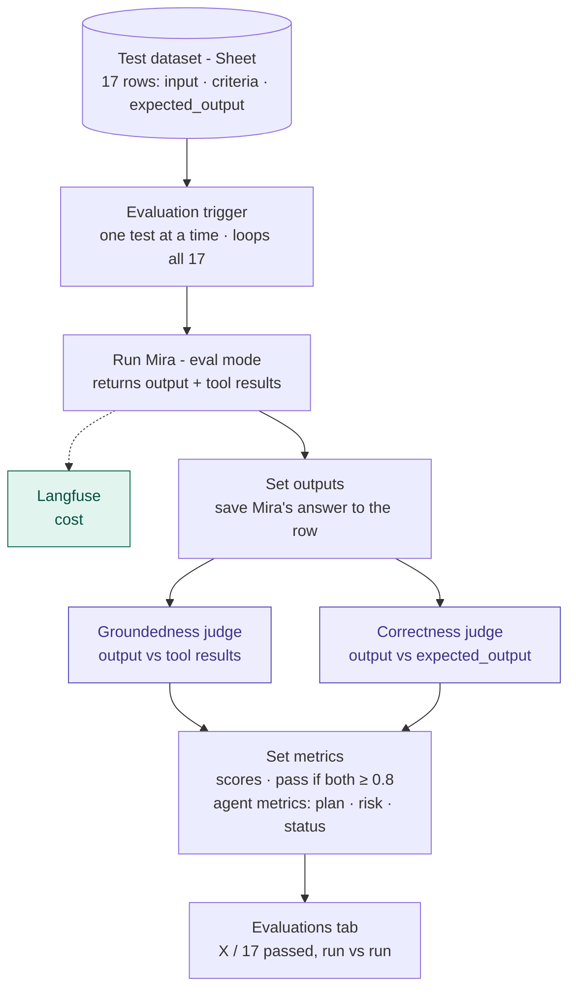

# 05 — Metric Implementation and LLM Cost

**Related:** [04 Metrics](04_evaluation_metrics.md) · [03 Ground truth](03_ground_truth.md) · [`ground_truth.json`](../data/ground_truth.json)

---

## Part A — Metric implementation

### A1. Evaluation workflow

Each test goes through Mira. Two LLM-judge **evaluators** then score the result: one for **Groundedness**, one for **Correctness**. Langfuse records the cost.



*Purple = LLM judge. Green = from traces. "Eval mode" means Mira skips the Slack approval and sends no emails during tests.*

### A2. What each evaluator receives (variable mapping)

As in Langfuse, each evaluator is **one judge prompt scoring one thing**, with variables filled from the run.

| Variable | Where it comes from | Groundedness | Correctness |
|---|---|---|---|
| `{{input}}` | Dataset row `input` (the test prompt) | ✓ | ✓ |
| `{{output}}` | Mira's final answer | ✓ | ✓ |
| `{{context}}` | **What Mira's tools returned in that run** (task rows, risk rows, timeline, description). In n8n: turn on the AI Agent option **"Return Intermediate Steps"**; Mira returns these tool results alongside its answer | ✓ | — |
| `{{criteria}}` | Dataset row `criteria`: the **marking scheme**, a short fixed list of what must be in the answer (from `judge_criteria` in `ground_truth.json`) | — | ✓ (grades against this) |
| `{{expected_output}}` | Dataset row `expected_output`: the **model answer**, full description with all facts | — | ✓ (fact check only) |

> **Why groundedness uses `{{context}}` and not `{{expected_output}}`:** groundedness asks "did Mira make anything up compared with what it actually retrieved?" Comparing against the answer key would measure correctness, which is a different question. For tests where Mira asks for clarification, no tools run, so the context is empty. Mira should then make no factual claims, which scores 1.

### A3. Evaluator 1 — Groundedness prompt (v1, unchanged since baseline)

Exactly as in n8n (`final-v1/prompts/groundedness_judge.txt`). The `{{ $(...) }}` parts are n8n expressions that fill in the test input, the tool results (`context`) and Mira's answer. The JSON format is enforced by a Structured Output Parser.

```text
You are evaluating whether an AI project assistant's answer is grounded in the data it retrieved.

USER REQUEST:
{{ $('Evaluation Trigger').item.json.input }}

RETRIEVED CONTEXT (the only facts the assistant was allowed to use):
{{ $('Run Mira').item.json.context }}

ASSISTANT OUTPUT:
{{ $('Run Mira').item.json.output }}

Instructions:
1. List every factual claim in the output about the project: task IDs/names, statuses,
   owners, due dates, counts, milestones, phases, risk IDs/descriptions, goals, percentages.
2. For each claim, decide: SUPPORTED (stated in or directly computable from the context)
   or UNSUPPORTED.
3. score = supported claims / total claims.
   - If the output contains no factual project claims (e.g. it only asks clarifying
     questions or says data is unavailable), score = 1.
   - If any task ID, risk ID, milestone, goal or percentage is invented, score = 0.
4. Ignore style, tone and completeness. Judge only whether claims are supported.

Return JSON with: score (0-1), unsupported_claims (list), reason (one sentence).
```

### A4. Evaluator 2 — Correctness prompt (v6, rubric with evidence quotes)

**How the Correctness judge scores** (example: T3, "Generate a risk assessment for the AI Adoption Project at ABCDE Ltd")

| Step | What the judge does | T3 example |
|---|---|---|
| 1 | Takes the test's **numbered criteria** one at a time | ① risk table with ID, category, risk, impact, mitigation · ② at least 6 risks, IDs R01–R10 · ③ live signals R09 (T024 Blocked), R01 (T006 overdue), R05 (T025 in progress) · ④ no IDs outside R01–R10 |
| 2 | For each item, **copies the words** from Mira's answer that meet it, as evidence. No evidence = not met. For a "does not contain" item, writes "absent" | ①②③ evidence quoted · ④ "absent" |
| 3 | Searches again before listing an item as missing | — |
| 4 | Uses the **expected answer** only to check facts (IDs, names, dates, counts) | e.g. that T024 is the blocked task |
| 5 | Scores: **1.0** all items met · **0.5** one or two not met · **0** three or more not met, or the wrong action (answered when it should have asked, or the reverse) | 1.0 |
| 6 | Returns the score, the evidence (one line per item), the items not met (`missing_items` column) and a one-sentence reason | missing: none |

The **criteria** are the marking scheme: short, numbered, required items, written once per test and the same on every run (`judge_criteria` in `ground_truth.json`, rewritten clearly in CHG-07). The **expected answer** is the model answer: longer, with optional details. Grading against fixed criteria is standard practice for LLM judges and keeps scores stable from run to run. Asking for evidence quotes (v6) stopped the judge from reporting items as missing that were in the answer, and from contradicting itself. Earlier versions are in `prompts/correctness_judge_v1.txt` … `v5.txt`; the history is in [06_change_log.md](06_change_log.md), CHG-01 to CHG-07b.

Exactly as in n8n (`final-v1/prompts/correctness_judge.txt`):

```text
You are an evaluator. Grade an AI project assistant's answer against a fixed checklist
(the CRITERIA) for this test. Be accurate: do not give credit for items that are not in
the answer, and do not report items as missing when they are in the answer.

USER REQUEST:
{{ $('Evaluation Trigger').item.json.input }}

CRITERIA (the checklist; each numbered item is one check):
{{ $('Evaluation Trigger').item.json.criteria }}

EXPECTED ANSWER (reference only, for the exact facts behind the criteria):
{{ $('Evaluation Trigger').item.json.expected_output }}

ASSISTANT OUTPUT:
{{ $('Run Mira').item.json.output }}

How to judge:
1. Take the numbered items in the CRITERIA, one at a time. Grade ONLY these items.
   Do not add requirements that the items do not state.
2. For each item, find the words in the ASSISTANT OUTPUT that meet it and copy them
   exactly as evidence. Same meaning counts (e.g. "team" meets "asks for the team size").
   - Task IDs and risk IDs (e.g. T024, R09) must appear exactly.
   - For a "does not contain ..." item, the item is met if that content is absent;
     write "absent" as the evidence.
   - If you cannot copy evidence from the output, the item is NOT met.
3. Before you list an item as missing, search the output again for it. Only list it if
   you still cannot find evidence.

Score:
1.0 = every item met
0.5 = 1 or 2 items not met
0.0 = 3 or more items not met, OR the assistant did the wrong action (answered when it
      should have asked, or asked when it should have answered)

Return JSON with: score (0, 0.5 or 1), evidence (list: one line per item, "<item number>: <copied words, absent, or NOT FOUND>"), missing_items (list of the items not met), reason (one sentence).
```

**Known limit:** on long table answers the judge is still not fully stable. In the final runs it failed the same T13 answer in final-1 and passed it in final-3, for a different (wrong) reason each time; the human review overruled it (change log, Final results).

**Judge model:** gpt-4.1 at temperature 0. It's deliberately a different model from all of Mira's (gpt-4o-mini, and gpt-4o for Risk and Status), and at least as capable, to avoid self-grading bias.

### A5. Where it runs — n8n (primary) or Langfuse (alternative)

**Option 1 — run everything in n8n (recommended).** One place to build, using n8n's built-in Evaluations.

| Step | n8n node | What it does |
|---|---|---|
| 1 | **Evaluation Trigger** | Reads the 12-row dataset (Google Sheet / Data Table imported from `mira_eval_dataset.csv`) and runs one row at a time |
| 2 | **Execute Workflow** | Calls Mira with `input` and `eval_mode: true` (skips Slack approval, email sending and saving to Google Docs). Mira returns `output` and `context` (tool results) |
| 3 | **Evaluation: Set Outputs** | Writes Mira's `output` back into the dataset row |
| 4 | **Basic LLM Chain** ×2 | Groundedness and Correctness prompts (A3, A4), each with a **Structured Output Parser** for the JSON |
| 5 | **Evaluation: Set Metrics** | Records `groundedness`, `correctness` and `pass` (both ≥ 0.8) |
| 6 | **Evaluations tab** | Shows averages per run and compares runs over time (before/after prompt changes) |

The three agent metrics (doc 04) are averages of these per-test scores, grouped by agent:
- **Plan groundedness** = average `groundedness` on T1, T2, T9, T14
- **Risk relevance** = average `correctness` on T3, T4, T7, T13, T15
- **Status accuracy** = average `correctness` on T5, T6, T8, T10, T11, T16

Tests are grouped by **what the user asked** (plan, risk or status request), not by which agent answered, so a Clarify test (e.g. T4) or a routing error (e.g. T15 in run-8 … run-10) still counts in its group. These averages are calculated in the results sheet, tab `summary` (one row per run tab), with a formula like this (Risk shown):
`=LET(r, INDIRECT("'"&INDEX($A:$A,ROW())&"'!A1:Z18"), h, INDEX(r,1,0), id, INDEX(r,0,1), v, INDEX(r,0,MATCH("correctness",h,0)), ROUND(AVERAGE(FILTER(v, REGEXMATCH(id,"^T(3|4|7|13|15)$"))),2))`
It reads the run tab named in column A, finds the `correctness` column, and averages it over the test IDs of that metric.

Cost is read from **Langfuse traces**, which every Mira run sends automatically once tracing is on (A7). Optionally, the two scores can be posted to the same Langfuse trace via the Langfuse Scores API (HTTP Request node), so everything is visible in one place.

**Option 2 — run the evaluators in Langfuse (as in the course).**
1. Upload `mira_eval_dataset.csv` as a Langfuse **dataset** (input, expected_output, metadata).
2. Create two **LLM-as-a-judge evaluators** in Langfuse with the prompts above. Map `{{input}}`, `{{output}}`, `{{expected_output}}` from the dataset item and trace. Map `{{context}}` from the tool-call observations in the trace.
3. Run each dataset item through Mira. Each trace must be **linked to its dataset item** (a dataset run) so Langfuse knows the expected output. From n8n this needs an HTTP Request to the Langfuse dataset-run API after each Mira call. That's the extra work compared with Option 1.
4. Langfuse scores every trace and shows averages per dataset run.

**Decision:** Option 1 for the build (simpler wiring, n8n Evaluations tab for screenshots), with Langfuse used for tracing and cost. Option 2 is a stretch goal if you want the scores in Langfuse exactly as in the course.

### A6. Optional — keyword check (Code node)

Not part of the metrics. If a judge ever passes an answer with a wrong number or ID, add a Code node after Mira that checks each test's required and forbidden keywords from its `metadata` in `ground_truth.json`:

```javascript
// item = dataset row; out = Mira's answer text
const m = JSON.parse(item.metadata);
const rx = p => new RegExp(p, 'i');
const missing   = (m.must_include_all || []).filter(p => !rx(p).test(out));   // e.g. T8 must mention T024
const forbidden = (m.must_not_include  || []).filter(p =>  rx(p).test(out));  // e.g. T12 must not mention T007–T025
return { keywords_ok: missing.length === 0 && forbidden.length === 0, missing, forbidden };
```

Use it as a cross-check only.

### A7. Tracing setup

**Langfuse via OpenTelemetry (tested and working on n8n Cloud).** At the end of Mira main:
1. A **Code node** builds the trace in OpenTelemetry (OTLP JSON) format: one root span for the request, plus child spans for each LLM call and tool call, including model name and token counts.
2. An **HTTP Request** node sends it with `POST https://cloud.langfuse.com/api/public/otel/v1/traces`, using a Basic Auth credential (public key / secret key).
3. Langfuse calculates cost from the model name and token counts.

A smoke-test workflow confirmed this end to end, including cost. Langfuse's older `/api/public/ingestion` endpoint also worked, but it shuts down on 2026-11-16, so it isn't used.

Tag each trace with `test_id` and `run_id` so traces line up with the results.

### A8. Results log (one row per test per run)

| run_id | test_id | input | expected_output | criteria | output | groundedness | unsupported_claims | correctness | groundedness_reason | correctness_reason | missing_items | llm_verdict | expected_keywords_present | hallucination_detected | human_verdict | human_note | cost_usd | trace_url |
|---|---|---|---|---|---|---|---|---|---|---|---|---|---|---|---|---|---|---|

`expected_keywords_present`, `hallucination_detected`, `human_verdict` and `human_note` are filled in by the PM after each run (A9); the first two follow the capstone playbook's Step 5 test-results format. Judge agreement = rows where `llm_verdict` = `human_verdict`.

### A9. Baseline evaluation

The **baseline** is the first full run of all 17 tests on the first working version of Mira, before any fixes. Every later run is compared with it.

1. **Freeze Mira v1.** Record the prompts, model (gpt-4o-mini), judge model (gpt-4.1) and `AS_OF_DATE` (2026-04-28).
2. **Run all 17 tests once** as run `baseline-v1`.
3. **Record per test:** groundedness, correctness, pass/fail, cost, judge reasons, trace link (results log, A8).
4. **Human review:** the PM reads all 17 outputs against the expected answers and fills in `expected_keywords_present`, `hallucination_detected`, `human_verdict` (Pass / Fail) and `human_note` in the results sheet (~20 min). Calculate **judge agreement** (LLM verdict vs human verdict).
5. **Review failures** (by human verdict) using the judge reasons and the Langfuse traces. Note the cause, e.g. wrong agent, wrong tool, or prompt issue.
6. **Fix and re-run all 17** as `run-2`, `run-3`, and so on (each change is logged in [06_change_log.md](06_change_log.md)). Always re-run every test, not just the failed ones, so fixes don't break something else.
7. **Stop** when the release gate in doc 04 is met, or when the remaining failures are documented as known limitations.

**Readability (the results sheet is a graded artifact).** After each run and human review:
1. Duplicate the `tests` tab and name it after the run (e.g. `baseline-v1`), since the next run overwrites the automatic columns.
2. Hide the technical columns (`metadata`, `context`, `path`, `unsupported_claims`) — kept as evidence, out of sight.
3. Visible columns, in reading order: **id · input · criteria · output · groundedness · groundedness_reason · correctness · correctness_reason · missing_items · llm_verdict · expected_keywords_present · hallucination_detected · human_verdict · human_note**.
4. Freeze row 1, wrap input/output text, colour verdicts (green Pass / red Fail).
5. In the write-up show only a summary table (Test · LLM verdict · Human verdict · Note + totals) and link to the sheet.

**For the write-up:** a table comparing baseline with the final run for each test, plus a short list of each failure and its fix. This feeds the Q4 "trace findings" and "improvement plan".

| Test | Baseline LLM (G / C) | Baseline human | Final LLM (G / C) | Final human | Fix made |
|---|---|---|---|---|---|
| T1 … T17 | | | | | |

*Result: baseline 4/12 brief and 3/5 extra tests passed (human verdict); final 12/12 and 5/5 in all 3 final runs. Per-change results: [06_change_log.md](06_change_log.md), "Versions" and "Final results".*

---

## Part B — LLM cost

**Models used**

| Part of Mira | Model | Price per 1M input tokens | Price per 1M output tokens |
|---|---|---|---|
| Orchestrator, Planner, Stakeholder | **gpt-4o-mini** | $0.15 | $0.60 |
| Risk, Status (upgraded in CHG-14 and CHG-16 for better reasoning) | **gpt-4o** (`gpt-4o-2024-11-20`) | $2.50 | $10.00 |
| Evaluation judges (Groundedness, Correctness) | **gpt-4.1** | $2.00 | $8.00 |

OpenAI list prices; verify before submission. Estimates below are replaced with real numbers from Langfuse after the baseline run.

### B1. Cost per request — Mira

> **Planning estimate (made before the build, all agents on gpt-4o-mini).** Risk and Status now use gpt-4o; the **actual** costs with the final models are in **B5**.


| Request type | Input tokens | Output tokens | Cost per request |
|---|---|---|---|
| Clarification (vague input: T2, T4, T6, T9) | ~1,800 | ~250 | ~$0.0004 |
| Status report / at-risk list / email | ~8,000 | ~1,200 | ~$0.002 |
| Risk matrix | ~9,000 | ~1,500 | ~$0.0023 |
| **Project plan** | ~10,000 | ~1,800 | **~$0.003** |

Every request includes one Orchestrator call (~900 input / 50 output tokens, ~$0.0002). Agents use more tokens because they call tools and re-read results (2–3 loop turns).

### B2. Cost per user per day — Mira

A typical PM day of ~8 requests, priced with the B1 costs:

| Request type | Requests per day | Cost each (B1) | Cost per day |
|---|---|---|---|
| Status report / at-risk list / email | 5 | ~$0.002 | ~$0.010 |
| Risk matrix | 1 | ~$0.0023 | ~$0.0023 |
| Project plan | 1 | ~$0.003 | ~$0.003 |
| Clarification (vague request) | 1 | ~$0.0004 | ~$0.0004 |
| **Total per PM per day** | **8** | | **~$0.016** |

| | Estimate |
|---|---|
| **Cost per PM per day** | **~$0.016** |
| **Cost per PM per month** (≈ 21 working days) | **~$0.34** |
| 10 PMs per month | ~$3.40 |

The daily mix is an assumption. Replace it with real usage once Mira is in use.

### B3. Evaluation cost — Mira + judges (gpt-4.1)

| Item | Per test | Per 12-test run |
|---|---|---|
| Mira answers the test (gpt-4o-mini) | ~$0.002 | ~$0.03 |
| Groundedness judge (gpt-4.1, ~4k in / 300 out) | ~$0.010 | ~$0.12 |
| Correctness judge (gpt-4.1, ~1.5k in / 100 out) | ~$0.004 | ~$0.05 |
| **Total** | | **~$0.20 per run** |

About 30 runs during development ≈ **$6**.

### B4. To check in traces

Compare the cost of **vague inputs** (T2, T4, T6, T9) with **detailed inputs**. Vague inputs should be the cheapest, because Mira stops at the Orchestrator and asks a question. If a vague input costs as much as a detailed one, Mira is probably generating an answer it shouldn't.

### B5. Actual cost with the final models (OpenAI usage, 2026-10-27)

Source: OpenAI **Usage** page (Cost by line item) and the token export (`openai_usage/completions_usage_2026-10-27_2026-10-27.csv`), for Mira's API key only. The usage day is in **UTC** (2026-10-27 00:00–24:00 UTC), so it covers the later evaluation runs (run-7 … run-11, final-1, final-2, final-3), earlier runs and judge-only re-runs that fell in that UTC day, and a few editor-chat tests. 942 judge calls ≈ 28 runs of 34 judge calls, so per-run figures below are worked out **per call**, not by dividing the day total. A second API key ("w6 key for langfuse and langflow": 650 gpt-4.1 + 325 gpt-4.1-mini requests, ≈ $0.44 that day) is not in the table. It was used by an **old Langfuse LLM-as-a-judge evaluator** that kept scoring Mira traces ("correctness" in Langfuse). That score is not one of Mira's metrics, and the evaluator is being turned off. Strictly, it is extra evaluation cost, so the day's evaluation-related total is ≈ $3.91.

| Model | Used by | Requests | Input tokens | Output tokens | Cost |
|---|---|---|---|---|---|
| gpt-4o (`gpt-4o-2024-11-20`) | Risk, Status (from run-10 / final-1) | 80 | 115,133 | 14,392 | $0.42 |
| gpt-4o-mini | Orchestrator, Planner, Stakeholder (and Risk/Status before the upgrade) | 771 | 842,835 | 79,685 | $0.18 |
| gpt-4.1 | Judges (Groundedness, Correctness) | 942 | 1,255,046 | 88,565 | ≈ $2.87 |
| **Total for the day** | | | | | **≈ $3.47** |

**Cost per model call (average):**

| Model | Tokens per call (in / out) | Cost per call |
|---|---|---|
| gpt-4o | 1,439 / 180 | ≈ $0.0053 |
| gpt-4o-mini | 1,093 / 103 | ≈ $0.0002 |

**Tokens and cost per request (final Mira)** — an agent request = 1 Orchestrator call + about 2 agent calls (one to call the tools, one to write the answer); built from the per-call averages above (gpt-4.1 judge call ≈ 1,330 in / 95 out):

| Request | Model calls | Input tokens | Output tokens | Cost |
|---|---|---|---|---|
| Clarify reply (vague input) | 1 gpt-4o-mini | ≈ 1,100 | ≈ 100 | < $0.001 |
| Plan or stakeholder request | 3 gpt-4o-mini | ≈ 3,300 | ≈ 300 | ≈ $0.001 |
| Risk or Status request | 1 gpt-4o-mini + 2 gpt-4o | ≈ 4,000 | ≈ 460 | ≈ $0.011 |
| Judging one test | 2 gpt-4.1 | ≈ 2,660 | ≈ 190 | ≈ $0.006 |
| One full evaluation run (17 tests) | ≈ 43 Mira calls + 34 judge calls | ≈ 99,000 | ≈ 9,000 | ≈ $0.21 |

These are per-model averages over all calls of the day, so a long plan uses more output tokens than a short answer. Input is mostly the system prompt, tool definitions and tool results. The exact tokens of a single request are in the n8n execution (each OpenAI Chat Model node reports its token usage).

**Findings**
- A gpt-4o call costs about **23×** a gpt-4o-mini call in practice (more than the 15–17× price ratio), because Risk and Status calls carry larger tool results. In absolute terms the upgrade adds **about 1 cent per Risk or Status request**, which was judged worth the better reasoning (change log CHG-14, CHG-16).
- **Judging with gpt-4.1 was the largest cost, because we ran the evaluation many times.** One run is cheap. But every change meant re-running and re-judging all 17 tests. On 2026-10-27 we judged about **28 runs' worth** (942 judge calls). That made the judges **≈ $2.87 of the day's ≈ $3.47 (83%)**. For comparison, on the same day gpt-4o cost $0.42 and gpt-4o-mini $0.18. A gpt-4.1 judge call costs ≈ $0.0030 (≈ 1,330 tokens in, 94 out), about 13× a gpt-4o-mini call. Judging one test (2 calls) costs ≈ **$0.006**, and judging one 17-test run (34 calls) ≈ **$0.10**. Judges run only during evaluation and do not affect the cost of using Mira.
- **One full final evaluation run ≈ $0.21:** judges ≈ $0.10 + Mira ≈ $0.11 (about 19 gpt-4o calls for the 9 Risk/Status tests + about 24 gpt-4o-mini calls). Before the gpt-4o upgrade, Mira's share was about $0.01 per run, so judging was over 90% of each run's cost.
- **Langfuse cost is an estimate, not the bill.** The "Build Langfuse trace" Code node estimates tokens from text length (about 300 tokens of system prompt per call) and labels every call as gpt-4o-mini. Real calls average about 1,100–1,440 input tokens, and Risk/Status now run on gpt-4o, so Langfuse under-states the cost. The OpenAI usage numbers above are the actual cost. Reading real token counts and the real model into the trace is a future improvement.
